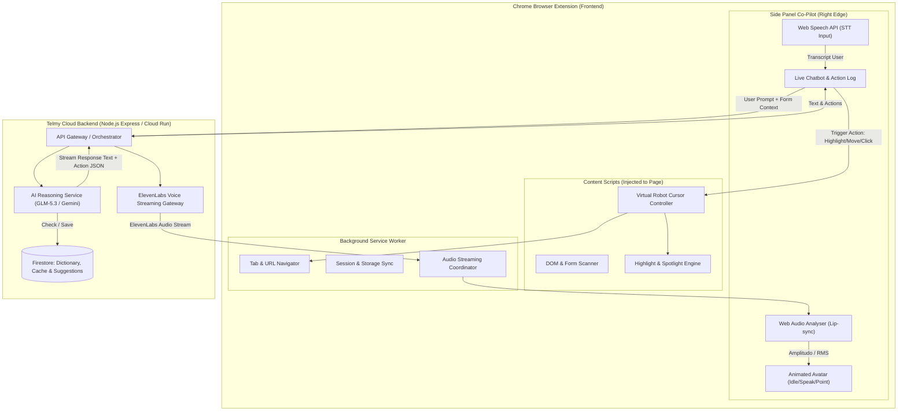

# PRD & Technical Plan: Telmy.ai (AI Form Explainer & Conversational Co-Pilot)

**Status:** PRD v2.0 (Evolusi dari MVP ke Multimodal Conversational Co-Pilot)  
**Platform:** Chrome Extension Manifest V3 + Node.js/Cloud Run + Firebase Firestore + Gemini / GLM-5.3 AI + ElevenLabs Voice Engine  
**Proyek Referensi & Inspirasi:** `telmy` core + modul otomasi & voice dari `gmt-extension-old` (GMT)

---

## 1. Ringkasan Eksekutif & Visi Produk

**Telmy.ai** adalah asisten cerdas (*multimodal AI form-filling & browser co-pilot*) yang memandu masyarakat umum maupun warga negara asing (WNA) dalam memahami, menavigasi, dan menyelesaikan pengisian formulir digital publik, portal perizinan (seperti OSS-RBA, Coretax, Imigrasi), hingga Google Forms.

Pada versi v2.0, Telmy bertransformasi dari sekadar pembaca dan penjelas form statis menjadi **Asisten Berbicara & Berinteraksi (Multimodal Conversational Co-Pilot)** dengan 4 pilar fitur revolusioner:
1. **Fitur Suara Interaktif (Voice Guidance & 2-Way Conversational Mode via ElevenLabs):** Suara panduan alami manusiawi dan percakapan suara dua arah (*talk to assistant*).
2. **Sinkronisasi Percakapan Chatbot di Side Panel:** Seluruh dialog suara ditranskripsikan dua arah ke dalam antarmuka obrolan (*live conversation stream*) di panel kanan dengan riwayat tersimpan persisten.
3. **Avatar Animasi Interaktif (3 Dynamic States):** Maskot/avatar visual yang responsif terhadap audio dan konteks panduan (State *Diam/Idle*, *Berbicara/Speaking*, dan *Bicara Sambil Menunjuk/Pointing*).
4. **Kontrol Kursor Robot & Otomasi Visual (Mouse Control, Highlight, Click, & URL Navigation):** Kursor virtual yang bergerak halus mengarahkan perhatian pengguna, menyorot elemen, mengeksekusi klik tombol, mengisi input, serta membuka/mengakses URL dengan prinsip *Human-in-the-Loop*.

---

## 2. Analisis & Pembelajaran dari `gmt-extension-old` (Brainstorming Retrospective)

Eksplorasi terhadap codebase legacy `old/gmt-extension-old` memberikan fondasi arsitektur dan pelajaran penting yang diadopsi dan disempurnakan ke dalam Telmy:

| Aspek / Fitur | Implementasi di `gmt-extension-old` | Peningkatan & Standardisasi di Telmy v2.0 |
| :--- | :--- | :--- |
| **Voice TTS** | Menggunakan ElevenLabs API stream (`eleven_multilingual_v2`) dan fallback ke `window.speechSynthesis` / `chrome.tts`. | **Audio-Reactive Pipeline:** Stream audio ElevenLabs dianalisis secara real-time melalui Web Audio API (`AnalyserNode`) untuk menggerakkan animasi bibir avatar (*lip-sync*), dengan fallback suara lokal yang stabil. |
| **Voice Input & Wake Word** | Menggunakan `webkitSpeechRecognition` dengan mode wake word *"Halo GMT"*. | **Conversational Voice Mode:** Pengenalan suara kontinu dwibahasa (ID/EN/ZH/JA/KO) dengan auto-silence detection, push-to-talk, atau hands-free conversation. |
| **Robot Cursor (Kursor Virtual)** | Elemen `#gmt-robot-cursor` dengan CSS absolute/fixed positioning, jeda manusiawi 1000ms, animasi `clicking`, dan *ripple effect*. | **Smart Smooth Path & Form Pointer:** Kursor neon Telmy terintegrasi dengan gestur avatar dan scroll halus (`scrollIntoView`), mendukung penyorotan bertahap tanpa membuat pengguna bingung. |
| **Interaksi DOM & Eksekusi** | Native setter injection (`HTMLInputElement.prototype.value`), dispatch `Event('input')`, `KeyboardEvent`, dan mouse events. | **Resilient Form Automation:** Standardisasi untuk berbagai jenis form (Google Forms `.M7eMe`, input dinamis, Shadow DOM, select/radio group) dengan validasi sebelum eksekusi. |
| **Navigasi Halaman** | Background worker memproses navigasi URL langsung (misal query YouTube/Google). | **Multi-step Wizard Form Navigator:** Telmy dapat memandu perpindahan tahapan URL formulir multipart (Step 1 -> Step 2) sambil mempertahankan sesi percakapan & suara tanpa putus. |
| **Side Panel & Layout** | CSS page-push (`margin-right: 390px` / shrink body) agar panel tidak menutupi form. | **Dipertahankan & Disempurnakan:** Desain Side Panel modern 380px Telmy yang responsif, dilengkapi chat history, progress tracker, dan avatar view. |

---

## 3. Spesifikasi 4 Fitur Baru Utama

### 3.1. Fitur Voice: Voice Guidance & Percakapan 2 Arah (ElevenLabs)

#### A. Deskripsi Fungsional
- **Voice Guidance:** Setiap instruksi atau penjelasan kolom dibacakan dengan suara alami berkualitas tinggi menggunakan **ElevenLabs API** (`eleven_multilingual_v2` / `eleven_turbo_v2_5`).
- **Mode Percakapan Aktif (Conversational Mode):** Pengguna dapat mengaktifkan toggle mikrofon/Voice Mode di header panel atau menekan shortcut mikrofon.
- **Interaksi Bebas Suara (Ngobrol):** Pengguna dapat bertanya bebas:
  - *"Telmy, tolong jelaskan apa maksud kolom NIB ini?"*
  - *"Apakah saya harus mengunggah paspor atau KTP?"*
  - *"Tolong klik tombol lanjut ke halaman berikutnya."*
  - *"Bantu saya isi bagian alamat domisili."*
- **Multilingual Voice Switch:** ElevenLabs otomatis menyesuaikan aksen dan bahasa berdasarkan bahasa aktif yang dipilih (Indonesia, English, Mandarin, Japanese, Korean).
- **Background Persistence (Uninterrupted Voice):** Menggunakan koordinasi audio service worker agar suara panduan tidak terputus saat halaman melakukan reload ringan atau AJAX navigation.

#### B. Pipeline Teknis
1. **User Audio Input:** Ditangkap menggunakan `webkitSpeechRecognition` (Web Speech API) atau audio stream buffer.
2. **LLM Orchestration:** Teks pengguna dikirim ke backend Telmy (GLM-5.3-Flash / Gemini) bersama konteks form saat ini (metadata form, field aktif, posisi halaman).
3. **Audio Synthesis (ElevenLabs):** Respons AI dikirim ke endpoint ElevenLabs TTS stream (`/v1/text-to-speech/{voice_id}/stream`).
4. **Playback & Frequency Analysis:** Audio diputar menggunakan `HTMLAudioElement` atau `AudioContext`, sekaligus mengirimkan data amplitudo/frekuensi ke modul Avatar untuk lip-sync.

---

### 3.2. Sinkronisasi Chatbot di Side Panel (Live Conversation Stream)

#### A. Deskripsi Fungsional
- Ketika Voice Mode aktif, interaksi suara **selalu dicerminkan ke dalam panel percakapan (chat stream) di sisi kanan**:
  - **Bubble Pengguna (User):** Menampilkan transkrip suara pengguna secara real-time (tampilan teks interim saat pengguna berbicara, lalu finalisasi).
  - **Bubble Asisten (Telmy):** Menampilkan balasan AI berupa teks rapi berformat (poin-poin, penjelasan, peringatan kesalahan).
  - **Action Pills / Execution Chips:** Jika AI menjalankan suatu aksi di halaman web, badge aksi interaktif disematkan di dalam bubble chat (contoh: `[🎯 Menyorot Kolom NIK]`, `[🖱️ Mengklik Simpan]`, `[🌐 Mengakses Halaman Formulir Data Diri]`).
- **Persistensi Sesi Percakapan:** Riwayat chat disimpan di `chrome.storage.local`. Jika tab ditutup atau berpindah halaman dalam domain yang sama, riwayat obrolan tidak terhapus.
- **Dukungan Input Hybrid:** Pengguna dapat beralih fleksibel antara berbicara lewat suara atau mengetik teks di kolom input chat bawah panel.

---

### 3.3. Fitur Avatar Interaktif (3 Dynamic Animated States)

#### A. Deskripsi Visual & Karakter
Avatar Telmy berwujud karakter robot pemandu ramah modern (*friendly tech companion*) yang disematkan di bagian atas Side Panel atau floating widget.

#### B. Tiga Status Animasi (Avatar States)

1. **State 1: Mode Diam (Idle / Listening)**
   - **Visual:** Bernapas perlahan (*subtle breathing animation*), mata berkedip secara natural setiap 3-5 detik.
   - **Indikator Audio:** Saat mikrofon mendengarkan suara pengguna, terdapat *listening pulse ring* (gelombang cahaya neon) di sekeliling avatar.
   - **Kondisi:** Aktif ketika asisten sedang menunggu input atau pengguna sedang membaca form.

2. **State 2: Mode Berbicara (Speaking / Talking)**
   - **Visual:** Mulut membuka-tutup secara dinamis mengikuti ritme intonasi suara, kepala sedikit mengangguk (*bobbing*).
   - **Audio-Reactive Lip-Sync:** Amplitudo audio dari ElevenLabs dibaca secara real-time melalui Web Audio API `AnalyserNode`. Nilai rata-rata RMS (0.0 - 1.0) memetakan tingkat keterbukaan mulut (morph target atau SVG path height).
   - **Kondisi:** Aktif saat audio ElevenLabs sedang diputar membacakan penjelasan umum atau menjawab pertanyaan pengguna.

3. **State 3: Mode Bicara Sambil Menunjukkan (Speaking + Pointing/Gesturing)**
   - **Visual:** Tangan/lengan avatar bergerak menunjuk ke arah kiri layar (menunjuk form/elemen target), tubuh sedikit condong ke kiri, ekspresi mata fokus mengarahkan pandangan ke formulir, sambil mulut tetap berbicara.
   - **Sinkronisasi:** Dipicu bersamaan dengan bergeraknya kursor robot virtual dan aktifnya spotlight pada field formulir tertentu.
   - **Kondisi:** Aktif saat asisten menjelaskan kolom spesifik (misal: *"Perhatikan kolom nomor 2 di sebelah kiri ini..."*) atau saat memandu langkah pengisian.

#### C. Arsitektur Teknis Avatar
- Menggunakan komponen **SVG / CSS Sprite & Canvas Animation** yang super ringan (< 50 KB), tidak membebani memori browser atau performa rendering halaman target.

---

### 3.4. Kontrol Kursor Robot & Otomasi Visual (Mouse Control & Form Actions)

#### A. Deskripsi Fungsional
Mengadopsi dan menyempurnakan arsitektur *Autopilot Robot Cursor* dari `gmt-extension-old`:
- **Virtual Robot Cursor (`#telmy-robot-cursor`):**
  - Kursor grafis khusus (ikon panah robotik neon dengan efek trail/glow) yang bergerak secara visual di atas lapisan viewport browser.
  - Pergerakan kursor menggunakan animasi lengkung halus (*ease-in-out cubic-bezier*) dengan jeda manusiawi (*human-like pacing ~800-1000ms*) sehingga pengguna memahami dengan jelas apa yang sedang ditunjuk.
- **Navigasi & Sorotan Elemen (Highlight Focus):**
  - Kursor meluncur ke elemen target formulir -> halaman otomatis melakukan scroll halus (`scrollIntoView({ behavior: 'smooth', block: 'center' })`).
  - Elemen target menyala dengan **Spotlight Ring & Focus Badge**, dan avatar masuk ke state *Pointing*.
- **Eksekusi Klik (Click Action):**
  - Kursor menyusut (animasi *pressing down*) -> memunculkan efek riak gelombang (*click ripple*) -> men-trigger event klik DOM (`pointerdown`, `mousedown`, `pointerup`, `mouseup`, `click`).
  - Mendukung klik tombol navigasi (*Berikutnya*, *Simpan Draft*), radio button pilihan, dan checkbox.
- **Navigasi URL (Access URL):**
  - Asisten dapat memandu pengguna membuka URL halaman formulir baru atau sub-halaman layanan perizinan secara otomatis via background service worker (`chrome.tabs.update`).
- **Human-in-the-Loop & Safety Confirmation:**
  - Aksi berisiko tinggi (misal: tombol *Kirim / Submit Akhir*, pembayaran/retribusi, penghapusan berkas) **wajib meminta konfirmasi pengguna** melalui dialog suara atau tombol konfirmasi (*"Apakah Anda yakin ingin mengirim formulir ini?"*).

---

## 4. Matriks Kebutuhan Fungsional (Updated Functional Requirements)

| ID | Kebutuhan Fungsional | Prioritas | Status / Sumber |
| :--- | :--- | :--- | :--- |
| **FR-1 s/d FR-15** | Pemindaian DOM form, kamus terverifikasi Firestore, fallback AI, badge nomor, rating & saran perbaikan, 5 bahasa (ID/EN/ZH/JA/KO), privasi metadata only. | Wajib | Dipertahankan dari MVP Telmy |
| **FR-16** | **ElevenLabs Voice Guidance:** Pembacaan instruksi form dan jawaban bantuan dengan suara natural ElevenLabs multilingual. | Wajib | Fitur Baru v2.0 |
| **FR-17** | **Two-Way Voice Conversation (Voice Mode):** Pengguna dapat mengaktifkan mikrofon dan berbincang dua arah secara interaktif dengan asisten Telmy. | Wajib | Fitur Baru v2.0 |
| **FR-18** | **Synchronized Chat Stream di Side Panel:** Seluruh percakapan suara ditranskripkan secara real-time ke panel obrolan di samping kanan dengan kartu ringkasan tindakan (*action chips*). | Wajib | Fitur Baru v2.0 |
| **FR-19** | **Interactive 3-State Animated Avatar:** Komponen avatar visual dengan state: (1) Idle/Listening, (2) Speaking (lip-sync audio reactive), dan (3) Speaking + Pointing ke arah elemen web. | Wajib | Fitur Baru v2.0 |
| **FR-20** | **Virtual Robot Cursor & Element Highlight:** Kursor virtual bergerak visual di layar, melakukan auto-scroll, menyorot kolom input, dan menampilkan animasi radar fokus. | Wajib | Fitur Baru (Adopsi GMT) |
| **FR-21** | **Automated Click & URL Navigation:** Kemampuan mengeklik elemen (tombol, radio, tab) dan menavigasi tab browser ke URL tujuan formulir. | Wajib | Fitur Baru (Adopsi GMT) |
| **FR-22** | **Safety Guardrails (Human-in-the-Loop):** Konfirmasi eksplisit sebelum melakukan klik aksi sensitif (*final submit*, hapus, transaksi pembayaran). | Wajib | Fitur Baru v2.0 |

---

## 5. Arsitektur Sistem Telmy v2.0

---

## 6. Desain Alur Interaksi Pengguna (User Journey)

### Skenario: Pengguna Mengisi Formulir Izin Usaha / Google Form dengan Voice Mode
1. **Aktivasi:** Pengguna membuka halaman formulir dan mengeklik ikon Telmy / menekan shortcut `Alt + G`. Panel samping terbuka (lebar 380px) dan halaman web menyusut (*push-page*).
2. **Avatar Menyapa:** Avatar berada di pojok atas panel dalam state **Idle**. Pengguna menekan tombol mikrofon (Voice Mode aktif). Avatar menampilkan aura denyut cahaya (*Listening*).
3. **Pengguna Berbicara:**  
   *User:* *"Halo Telmy, ini form apa ya? Saya harus mulai dari mana?"*  
   -> Teks suara pengguna langsung muncul sebagai bubble chat di Side Panel.
4. **Telmy Menjawab & Bergerak:**
   - LLM merumuskan jawaban + perintah aksi: `{"action": "HIGHLIGHT_FIELD", "index": 0, "say": "Ini adalah formulir pendaftaran izin usaha. Langkah pertama, isi nama lengkap sesuai KTP pada kolom pertama ini."}`.
   - Suara ElevenLabs streaming mulai berbunyi.
   - **Avatar beralih ke state Pointing + Speaking:** Mulut avatar bergerak sinkron dengan audio, dan tangannya menunjuk ke arah kolom pertama di sebelah kiri.
   - **Kursor Robot Meluncur:** `#telmy-robot-cursor` meluncur dengan animasi mulus ke kolom pertama, halaman otomatis ter-scroll, dan kolom pertama menyala terang dengan cincin spotlight neon.
   - **Chat Log Terisi:** Penjelasan Telmy tertulis lengkap di panel chat beserta tombol *Contoh Isian* dan *Salin Teks*.
5. **Perintah Otomasi / Klik:**  
   *User:* *"Bisa tolong klik tombol Lanjut ke halaman berikutnya?"*  
   - Telmy: *"Baik, mengarahkan ke tombol Lanjut..."*
   - Kursor robot bergerak ke tombol *Next/Lanjut*, jeda 1 detik, kursor menekan tombol, muncul efek riak klik (*ripple*), dan halaman berpindah.
   - Jika tombol adalah tombol *Submit Akhir*, Telmy memunculkan modal konfirmasi: *"Ini adalah tombol pengiriman akhir. Apakah data Anda sudah benar dan siap dikirim?"*.

---

## 7. Rencana Kerja Implementasi (Sprint & Roadmap)

### Tahap 1: Integrasi Voice Engine & Side Panel Chat (Hari 1 - 3)
- [x] Pemindaian formulir & kamus Firestore (Fondasi MVP Telmy selesai).
- [ ] Implementasi modul `voiceService.js` (ElevenLabs API integration + Web Speech STT).
- [ ] Redesain antarmuka Side Panel untuk mendukung komponen chat dua arah (*user bubble*, *assistant bubble*, dan *action chip*).
- [ ] Sinkronisasi riwayat obrolan ke `chrome.storage.local`.

### Tahap 2: Animasi Avatar & Audio-Reactive Lip Sync (Hari 4 - 6)
- [ ] Pembuatan aset vektor SVG/Canvas avatar dengan 3 layer: base body, eyes, mouth, and arm/pointer.
- [ ] Integrasi Web Audio API `AudioContext` + `AnalyserNode` untuk mendeteksi intensitas volume stream ElevenLabs secara real-time.
- [ ] State machine controller avatar: transisi halus antar state `idle` ⇄ `speaking` ⇄ `pointing`.

### Tahap 3: Virtual Robot Cursor & Browser Automation Engine (Hari 7 - 9)
- [ ] Porting dan modularisasi `#gmt-robot-cursor` dari `gmt-extension-old` ke dalam `telmy/extension/content/robot-cursor.js`.
- [ ] Pemetaan aksi terstruktur dari respons AI: `highlight(fieldId)`, `move_cursor(x, y)`, `click(selector)`, `navigate(url)`.
- [ ] Penambahan modul Safety Guardrails (Human-in-the-Loop) untuk aksi sensitif.

### Tahap 4: Pengujian Terpadu, Validasi, & Demo Polishing (Hari 10 - 12)
- [ ] Uji coba skenario lengkap pada halaman simulasi (`demo_apostille.html`) dan Google Form nyata.
- [ ] Optimasi latensi (ElevenLabs turbo stream + caching frasa umum).
- [ ] Penyusunan dokumentasi dan materi demo pitch hackathon.