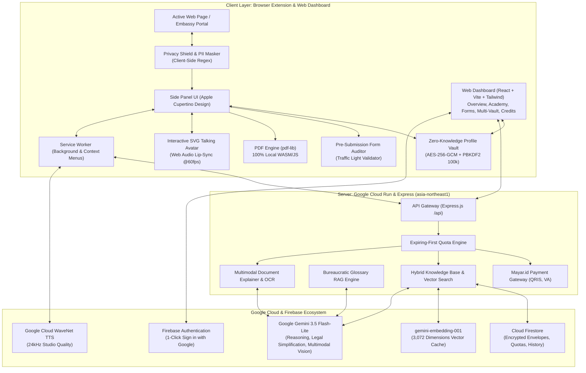

# 🌐 Telmy.ai: The Friendly AI Form-Filling Companion & Co-Pilot

<p align="center">
  
</p>

<p align="center">
  <strong>Transforming complex government paperwork, international visa portals, and scholarship applications into an intuitive, conversational, and stress-free journey.</strong>
</p>

<p align="center">
  <a href="https://telmy.id" target="_blank">
    
  </a>
  <a href="https://github.com/arfabi/telmy.ai" target="_blank">
    
  </a>
</p>

<p align="center">
  
  
  
  
  
  
  
  
</p>

---

## 📑 Table of Contents

- [📖 The Story & Problem](#-the-story--problem-why-we-built-telmyai)
- [🏛️ System Architecture](#️-system-architecture)
- [🛠️ Google Technology Stack](#️-complete-google-technology-stack-100-google-ai--cloud-native)
- [🌟 Feature Highlights (Extension & Dashboard)](#-comprehensive-feature-breakdown-extension--dashboard)
- [🌍 Supported Languages](#-supported-languages-11-japac--global-languages)
- [🚀 Quickstart & Setup Guide](#-quickstart--setup-guide)
  - [Step 1: Backend Setup](#step-1-configure--start-backend)
  - [Step 2: Frontend Setup](#step-2-configure--start-frontend-web-platform)
  - [Step 3: Browser Extension Installation](#step-3-install-browser-extension-chrome-edge-opera--firefox)
- [☁️ Cloud Run Deployment](#️-deployment-to-google-cloud-run)
- [🔒 Chrome Web Store & Privacy Compliance](#-chrome-web-store--privacy-compliance)
- [💎 Why Telmy.ai Stands Out](#-why-telmyai-stands-out)
- [📄 License & Credits](#-license--credits)

---

## 📖 The Story & Problem: Why We Built Telmy.ai

Every year, millions of citizens, international students, foreign travelers, and small business owners encounter digital bureaucracy:

> *You are trying to submit an international scholarship, embassy visa, or government apostille application late at night.*  
> *You are confronted with 30 intimidating input fields packed with unfamiliar legal terms like "Apostille Authentication", "Substituted Power of Attorney", "Affidavit of Support", or "Tax Identification Number / TIN".*  
> *A single mistake — such as including an academic title in a passport family name field, entering a date in an inverted format, or missing an international postal code — leads to instant disqualification and lost application fees.*  
> *Generic browser translators fail completely: they mistranslate official legal acronyms into confusing words and break critical submit buttons.*

### Meet Telmy: Your Patient, Friendly Co-Pilot
**Telmy.ai** was built upon a simple human principle: **No one should ever feel alone, anxious, or helpless when completing official digital paperwork.**

Telmy is a warm, intelligent companion that lives in your browser's native **Chrome Side Panel** and is supported by a comprehensive web dashboard. As you navigate any complex portal or open a downloaded embassy PDF form, Telmy sits right alongside your page. It points to each question, explains what it means in plain everyday words, offers realistic examples, validates your input before submission, and narrates answers aloud with a talking mascot avatar.

---

## 🏛️ System Architecture



---

## 🛠️ Complete Google Technology Stack (100% Google AI & Cloud Native)

Telmy.ai is architected natively around the Google Cloud & Google AI ecosystem:

| Layer | Google Technology | Model / Service Version | Implementation Role in Telmy.ai |
| :--- | :--- | :--- | :--- |
| **Generative Intelligence (LLM)** | **Google Gemini API** | `gemini-3.5-flash-lite` | Core reasoning engine for field semantic analysis, plain-language legal simplification, conversational copilot chat, and JAPAC translation matrix. |
| **Multimodal Vision (Vision AI)** | **Google Gemini Multimodal Vision** | `gemini-3.5-flash-lite` (`inlineData`) | Real-time viewport screenshot reasoning paired with live DOM grounding (replicating & outperforming Chrome's native Ask Gemini). Understands page layouts, identifies visual seals/logos, and discovers interactive action buttons. |
| **Multimodal OCR (Ingestion)** | **Google Gemini Multimodal** | `gemini-3.5-flash-lite` | Zero-retention OCR extracting identity fields from photos of KTP, Passports, and Diplomas directly into structured JSON in volatile RAM. |
| **Vector Embeddings (RAG)** | **Google Gemini Embedding** | `gemini-embedding-001` (3,072 dimensions) | Generates high-fidelity semantic vectors for form field labels and legal terms to power Zero-Token cosine similarity caching. |
| **Voice Synthesis (TTS)** | **Google Cloud Text-to-Speech** | WaveNet Neural Synthesis (`id-ID-Wavenet-A`, `en-US-Wavenet-F`, etc.) | High-performance natural voice generation reading form field explanations aloud, dynamically driving the SVG talking mascot lip-sync. |
| **Database & Realtime Sync** | **Firebase Cloud Firestore** | Google Cloud Firestore (Native Mode) | Stores client-encrypted ciphertext envelopes, user quotas, saved form draft states, and active connected devices. |
| **Semantic Vector Cache** | **Firestore Vector Search** | Cosine Similarity ($\ge 0.90$) | Cross-domain semantic matching across stored Firestore entries, serving cached explanations instantly with zero LLM token costs. |
| **User Identity & Auth** | **Firebase Authentication** | Google Identity & OAuth 2.0 | Seamless 1-Click "Sign in with Google" bridging the Web Platform, Member Dashboard, and Chrome Side Panel. |
| **Production Cloud Hosting** | **Google Cloud Run** | Fully Managed Serverless (`asia-northeast1`) | Unified Docker container serving the Express.js Backend API and the React Web Dashboard with custom domain mapping (`https://telmy.id`). |
| **Automated CI/CD** | **Google Cloud Build** | Continuous Deployment Pipeline | Automatically triggers multi-stage Docker build and zero-downtime deployment on push to GitHub. |
| **Client Platform** | **Google Chrome Extensions API** | Manifest V3 (MV3) | Chrome Native Side Panel (`chrome.sidePanel`), Service Worker lifecycle, Chrome Storage (`chrome.storage.local`), Context Menus, and DOM MutationObserver. |
| **Speech Fallback** | **Google Web Speech API** | Client-Side Speech Synthesis & Recognition | Offline fallback voice synthesis and microphone voice-to-text input. |
| **Design Typography** | **Google Fonts** | Inter, Outfit, Roboto | Modern, accessible typography system for web and sidepanel interfaces. |

---

## 🌟 Comprehensive Feature Breakdown (Extension & Dashboard)

### 🧩 1. Browser Extension Core Features (8 Main Action Suite)

The Telmy Side Panel features 8 unified, one-click action cards designed to guide users through every stage of online bureaucracy:

| Feature Name | Benefits | Real-World Use Case | How-To Tutorial (Step-by-Step) |
| :--- | :--- | :--- | :--- |
| **🔍 Analyze Form** | Instantly scans the entire web page, removes noise, identifies all interactive inputs, renders sequential numbered badge overlays on the DOM, and generates plain-language explanations in the Forms Guide. | Navigating a 30-field scholarship application or embassy visa portal packed with confusing legal acronyms and unorganized sections. | 1. Open any complex form in your browser.<br>2. Press `Alt + T` or click the Telmy icon in your toolbar to open the Side Panel.<br>3. Click the **"Analyze Form"** card.<br>4. Telmy scans the page and paints numbered badges (`1, 2, 3...`) next to every input.<br>5. Check the **Forms Guide** tab to review field meanings one by one. |
| **✂️ Explain This** | Pixel-precise screen snipping tool (Lightshot-style). Crop any confusing button, seal, ambiguous sentence, or table on your screen. Gemini Multimodal Vision combines the crop with page metadata (`title`, `URL`, surrounding DOM text) to provide instant clarity. | Encountering an ambiguous checkbox, unfamiliar fee table, or confusing government apostille instruction that generic translators cannot interpret. | 1. Click the **"Explain This"** card in the Side Panel.<br>2. The webpage dims with a semi-transparent overlay and your cursor turns into a crosshair.<br>3. Click and drag a rectangular box over the confusing element.<br>4. Release the mouse. Telmy automatically crops the pixels, extracts surrounding context, and sends it to the AI assistant.<br>5. Read the explanation and actionable advice directly in the chat! |
| **⚡ 1-Click Auto Fill** | Safely decrypts your client-side profile vault and populates matching form fields in under 1 second without typing mistakes or copy-pasting. | Entering repetitive personal details (passport number, expiry date, national ID, address, phone) across multiple portals. | 1. Ensure you have saved your profile credentials in the **AutoFill / Vault** tab.<br>2. Click **"1-Click Auto Fill"** on the welcome menu or open the AutoFill tab.<br>3. Enter your Master PIN or 12-word recovery seed phrase.<br>4. Telmy matches inputs semantically and fills all corresponding fields automatically with zero typing errors. |
| **📄 Upload Local Form** | In-browser PDF engine powered by `pdf-lib` (WASM/JS). Reads, explains, fills, and certifies downloaded government PDF forms 100% locally with zero data leaks. | Filling downloaded embassy visa application PDFs, tax forms, or university enrollment paperwork offline or in-browser. | 1. Click **"Upload Local Form"** in the Side Panel.<br>2. Drag and drop your `.pdf` file into the designated upload area.<br>3. Telmy parses the interactive AcroForm fields and explains each clause step-by-step.<br>4. Fill in your answers and click **"Export Filled PDF"** to download the completed official document. |
| **🌐 Translate Page** | In-place, context-aware DOM translation that translates labels, placeholders, and buttons into your native language without breaking React/Angular state or event listeners. | Completing a Japanese MEXT, German DAAD, or South Korean KGSP scholarship form written entirely in a foreign language. | 1. While on the foreign language portal, click **"Translate Page"**.<br>2. Telmy swaps labels and placeholders into your selected language in real time.<br>3. Click the button again at any time to toggle back to the original source text. |
| **👆 Show Me** | Spatial visual spotlight navigation. Type or ask where an elusive button, section, or link is located, and Telmy glides an animated pointer and neon beacon directly to it. | Frantically searching for hidden buttons like *"Submit Application"*, *"Add Recommendation"*, or *"Download Receipt"*. | 1. Click **"Show Me"** on the welcome menu (or type `"Show me section about [keyword]"` in chat).<br>2. Enter the name of the button or section you are looking for.<br>3. Watch the webpage smoothly scroll: a glowing neon spotlight beacon and flying pointer will pulse right on top of the target element! |
| **🛡️ Form Auditor** | Pre-submission sanity checker utilizing a Traffic Light verification system (🟢 Green, 🟡 Yellow, 🔴 Red) to catch critical mistakes before submitting. | Preventing application disqualification due to missing mandatory inputs, inverted dates (`MM/DD/YYYY` vs `DD/MM/YYYY`), or academic titles in passport name fields. | 1. Complete your form inputs on the webpage.<br>2. Click **"Form Auditor"** in the Side Panel before pressing the official Submit button.<br>3. Telmy runs client-side audit rules across all inputs.<br>4. Review the traffic light report: fix any 🔴 Critical missing fields or 🟡 Formatting warnings. When 🟢 Ready to Submit appears, you're safe to submit! |
| **♿ Accessibility** | Full WCAG 2.2 AA compliant dedicated hub featuring 1-click situational presets (ADHD Focus, Dyslexia Font, Low Vision, Senior Friendly) and customizable visual adjustments. | Users with visual fatigue, ADHD, dyslexia, or seniors who need high contrast, larger text, or guided reading bars to complete forms comfortably. | 1. Click **"Accessibility"** in the Side Panel (or press `Ctrl + U`).<br>2. Select a preset (e.g., **ADHD Focus** to dim distractions or **Dyslexia** to switch to dyslexia-friendly fonts).<br>3. Customize line spacing, text alignment, or contrast themes.<br>4. Click **"Reset"** or **"Kembali"** when finished to restore normal website styling. |

---

### 💻 2. Modern Web Dashboard Platform (`/dashboard`)

| Feature Name | Benefits | Real-World Use Case | How-To Tutorial (Step-by-Step) |
| :--- | :--- | :--- | :--- |
| **📊 Overview & Quota Monitor** | Live visibility over remaining form credits, active membership tiers, connected devices, and anxiety-reduction daily tips. | Monitoring daily form analysis quota and checking subscription limits before starting a major visa application session. | 1. Log in at `https://telmy.id/dashboard`.<br>2. View your real-time quota pill and active tier badge at the top of the page.<br>3. Check recent activity logs and quick-launch links. |
| **🎓 Telmy Academy** | Interactive gamified onboarding with 5 structured missions. Educates users on form navigation while awarding instant bonus form credits. | New users learning how to use browser side panels, configure vault encryption, and audit documents safely. | 1. Navigate to the **Academy** tab in the dashboard.<br>2. Complete missions (e.g., install extension, setup master vault, run first audit).<br>3. Click **"Claim Reward"** to unlock bonus form credits added straight to your balance. |
| **🔐 Zero-Knowledge Multi-Vault** | Mathematical client-side encryption (AES-256-GCM + PBKDF2 100k iterations). Organize custom profiles (Personal, Spouse, Children, Parents) with unlimited custom key-value pairs. | Securely storing sensitive NIK, passport numbers, birth certificate dates, and family records with zero server-side plaintext leakage. | 1. Open the **Vault** page in the dashboard.<br>2. Enter your 6-digit Master PIN or 12-word seed phrase.<br>3. Add or edit custom fields (e.g., `Passport No | A1234567`).<br>4. Click **Save**: data is encrypted in your browser's RAM before sync. |
| **📑 Forms History & Draft Locker** | Cloud draft management allowing users to track previously analyzed forms, view past audit reports, and resume interrupted applications. | Resuming a complex visa application that spans across multiple days without losing entered information or past audit advice. | 1. Open **Forms History** in the dashboard.<br>2. Locate your application by domain name or date.<br>3. Click **"Resume"** to reopen the portal with all previously mapped badges intact. |
| **💳 Mayar.id Payments & Tiers** | Instant self-serve credit top-ups supporting Indonesian QRIS (GoPay, OVO, DANA, ShopeePay), Virtual Accounts, and international credit cards. | Upgrading from Free Tier (5 forms) to Standard/Pro tiers during peak scholarship or visa filing seasons. | 1. Go to the **Pricing & Credits** section.<br>2. Select your desired tier (Standard 25, Pro 75, or Max 200).<br>3. Scan the generated QRIS code with any Indonesian e-wallet or pay via bank transfer.<br>4. Credits are credited instantly via automated webhook. |

---

## 🌍 Supported Languages (11 JAPAC & Global Languages)

Telmy supports 11 major languages natively across guidance, translation, voice synthesis, and UI:

| Flag | Language | Native Name | Code | Voice Engine |
| :---: | :--- | :--- | :---: | :---: |
| 🇬🇧 | **English (Default)** | English | `en` | ✅ WaveNet Neural (`en-US-Wavenet-F`) |
| 🇮🇩 | **Indonesian** | Bahasa Indonesia | `id` | ✅ WaveNet Neural (`id-ID-Wavenet-A`) |
| 🇯🇵 | **Japanese** | 日本語 | `ja` | ✅ WaveNet Neural (`ja-JP-Wavenet-B`) |
| 🇰🇷 | **Korean** | 한국어 | `ko` | ✅ WaveNet Neural (`ko-KR-Wavenet-A`) |
| 🇨🇳 | **Simplified Chinese** | 简体中文 | `zh` | ✅ WaveNet Neural (`cmn-CN-Wavenet-A`) |
| 🇹🇼 | **Traditional Chinese** | 繁體中文 | `zh-TW` | ✅ WaveNet Neural (`cmn-TW-Wavenet-A`) |
| 🇻🇳 | **Vietnamese** | Tiếng Việt | `vi` | ✅ WaveNet Neural (`vi-VN-Wavenet-A`) |
| 🇹🇭 | **Thai** | ไทย | `th` | ✅ WaveNet Neural (`th-TH-Standard-A`) |
| 🇮🇳 | **Hindi** | हिन्दी | `hi` | ✅ WaveNet Neural (`hi-IN-Wavenet-A`) |
| 🇵🇭 | **Filipino** | Filipino | `fil` | ✅ Web Speech Synthesis |
| 🇲🇾 | **Malay** | Bahasa Melayu | `ms` | ✅ Web Speech Synthesis |

---

## 🚀 Quickstart & Setup Guide

### Prerequisites
* **Node.js** v20+ or v22+
* **Google Chrome** (Version 114+ with Native Side Panel support), Edge, Firefox, or Opera
* **Google Gemini API Key** ([Google AI Studio](https://aistudio.google.com/))

---

### Step 1: Configure & Start Backend
```bash
# 1. Navigate to backend
cd backend

# 2. Install dependencies
npm install

# 3. Create .env file
cp ../.env.example .env
```

Ensure your `backend/.env` contains:
```env
PORT=8080
NODE_ENV=development
AI_PROVIDER=gemini
GEMINI_API_KEY=your_gemini_api_key_here
GEMINI_MODEL=gemini-3.5-flash-lite
GOOGLE_TTS_API_KEY=your_gemini_api_key_here
EXPLAIN_STRATEGY=AI_FIRST
GOOGLE_TTS_REFERER=https://telmy.id/
```

Start the backend development server:
```bash
npm run dev
```
*Backend runs at `http://localhost:8080` (Health check: `http://localhost:8080/health`).*

---

### Step 2: Configure & Start Frontend Web Platform
```bash
# In a new terminal
cd frontend

# Install dependencies
npm install

# Start Vite development server
npm run dev
```
*Frontend runs at `http://localhost:5173` (Vite dev server proxies `/api` requests to backend at `8080`).*

---

### Step 3: Install Browser Extension (Chrome, Edge, Opera, & Firefox)

#### Google Chrome / Microsoft Edge / Opera / Brave:
1. Open `chrome://extensions/` (or `edge://extensions/`).
2. Toggle on **Developer mode** (top-right).
3. Click **Load unpacked** (top-left) and select the `extension/` folder.
4. Pin Telmy to your toolbar. Press **`Alt + T`** or click the Telmy icon to open the Sidepanel!

#### Mozilla Firefox:
1. Open `about:debugging#/runtime/this-firefox`.
2. Click **Load Temporary Add-on...**
3. Select `dist-extensions/telmy-firefox.zip` (generated via packaging script).

#### Automated Dual-Browser Packaging (1-Click):
Run the packaging script to generate store-ready ZIPs:
* **Windows Batch:** Double-click `build-extensions.bat`
* **PowerShell:** `powershell -ExecutionPolicy Bypass -File .\build-extensions.ps1`
* Produces:
  - `dist-extensions/telmy-chrome-edge.zip` (Chrome MV3 Side Panel)
  - `dist-extensions/telmy-firefox.zip` (Firefox Gecko Sidebar Action)

---

## ☁️ Deployment to Google Cloud Run

Telmy uses a **Unified Multi-Stage Dockerfile** at the root of the project. The Docker build automatically compiles the React Vite frontend, embeds assets into the Express production runner, and serves the whole application from a single high-performance container:

```bash
# Deploy directly from the project root using Google Cloud CLI
gcloud run deploy telmy-backend \
  --source . \
  --region asia-northeast1 \
  --allow-unauthenticated \
  --set-env-vars GEMINI_API_KEY="AIzaSy...",FIREBASE_PROJECT_ID="guidemeto-bdf36",EXPLAIN_STRATEGY="AI_FIRST",GOOGLE_TTS_REFERER="https://telmy.id/"
```

---

## 🔒 Chrome Web Store & Privacy Compliance

Telmy.ai was engineered to be **100% compliant** with Google Chrome Web Store Developer Policies and privacy regulations:
* **Least Privilege Principle:** Only requests essential permissions: `storage`, `activeTab`, `tabs`, `scripting`, `sidePanel`, and `contextMenus`.
* **Zero Wildcard Hosts:** `host_permissions` only whitelists the official API domain (`https://telmy.id/*`).
* **Zero Remote Code Execution (No CDN/eval):** All vendor libraries (`pdf-lib.min.js`, Lucide icons, avatar engines) are bundled locally.
* **User-Initiated Actions Only:** Forms are auto-filled only upon explicit user request; no stealth DOM alterations or passive trackers.
* **Zero-Knowledge Encryption:** Profile secrets never leave client memory without AES-256 encryption.

---

## 💎 Why Telmy.ai Stands Out

| Core Pillar | Telmy.ai Implementation & Engineering Highlights |
| :--- | :--- |
| **Comprehensive Google AI Integration** | Fully integrated with **Google Gemini 3.5 Flash-Lite**, **Gemini Multimodal Vision**, **Gemini Embeddings**, **Google Cloud WaveNet TTS**, **Firebase Firestore**, and **Google Cloud Run**. |
| **Human Impact & Digital Equity** | Solves digital bureaucracy anxiety for international students, job seekers, and senior citizens, supporting 11 native languages with spoken explanations and visual guidance. |
| **Privacy by Design** | Mathematical Zero-Knowledge Client-Side Encryption (PBKDF2 100k + AES-256-GCM) and Zero Document Retention for uploaded identity cards and diplomas. |
| **Product Maturity & Polish** | Full cross-browser support (Chrome, Edge, Firefox, Opera), live web platform with member dashboard, contextual right-click menus, and Mayar payment gateway. |

---

## 📄 License & Credits
Created with ❤️ by the **Telmy.ai Team** for the **Google AI Hackathon 2026** (Hack2skill).  
*Empowering digital accessibility, cross-border paperwork, and barrier-free opportunities for all.*
