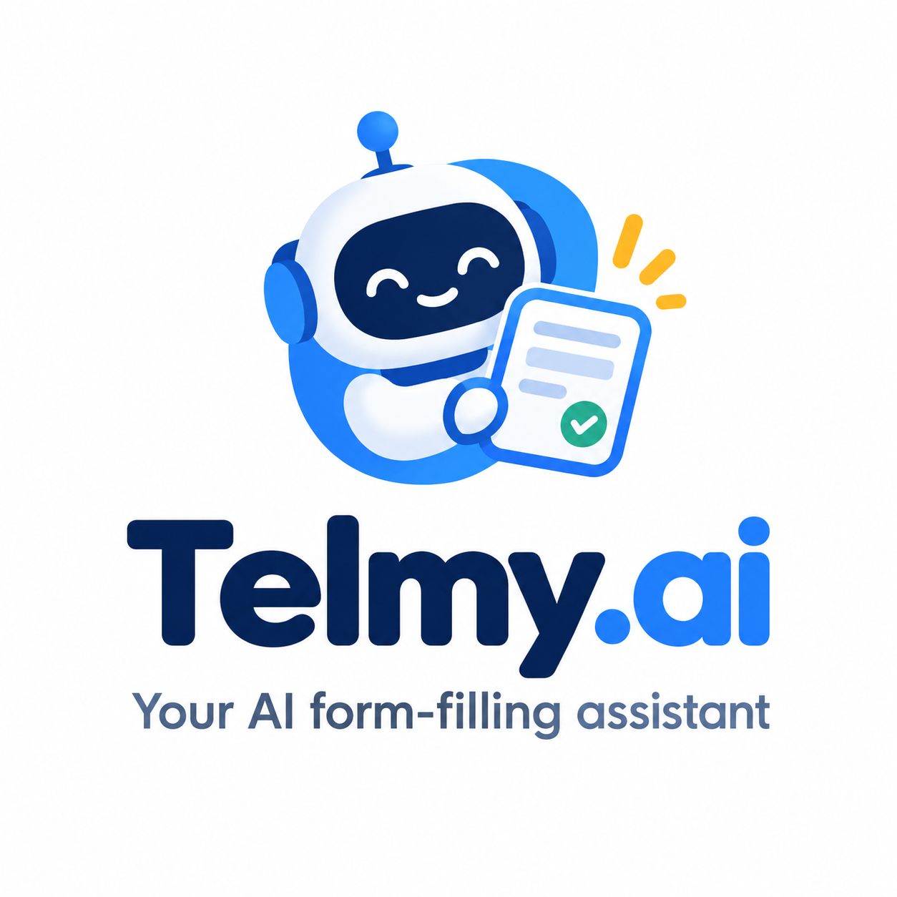
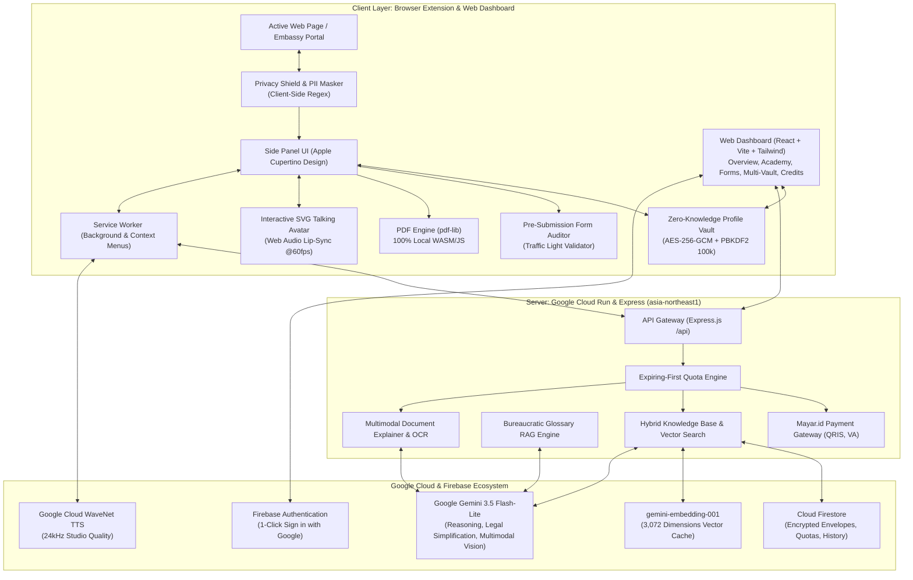

# 🌐 Telmy.ai: The Friendly AI Form-Filling Companion & Co-Pilot

<p align="center">
  
</p>

<p align="center">
  <strong>Transforming complex government paperwork, international visa portals, and scholarship applications into an intuitive, conversational, and stress-free journey.</strong>
</p>

<p align="center">
  <a href="https://telmy.id" target="_blank">
    
  </a>
  <a href="https://github.com/arfabi/telmy.ai" target="_blank">
    
  </a>
</p>

<p align="center">
  
  
  
  
  
  
  
  
</p>

---

## 📑 Table of Contents

- [📖 The Story & Problem](#-the-story--problem-why-we-built-telmyai)
- [🏛️ System Architecture](#️-system-architecture)
- [🛠️ Google Technology Stack](#️-complete-google-technology-stack-100-google-ai--cloud-native)
- [🌟 Feature Highlights (Extension & Dashboard)](#-comprehensive-feature-breakdown-extension--dashboard)
- [🌍 Supported Languages](#-supported-languages-11-japac--global-languages)
- [🚀 Quickstart & Setup Guide](#-quickstart--setup-guide)
  - [Step 1: Backend Setup](#step-1-configure--start-backend)
  - [Step 2: Frontend Setup](#step-2-configure--start-frontend-web-platform)
  - [Step 3: Browser Extension Installation](#step-3-install-browser-extension-chrome-edge-opera--firefox)
- [☁️ Cloud Run Deployment](#️-deployment-to-google-cloud-run)
- [🔒 Chrome Web Store & Privacy Compliance](#-chrome-web-store--privacy-compliance)
- [💎 Why Telmy.ai Stands Out](#-why-telmyai-stands-out)
- [📄 License & Credits](#-license--credits)

---

## 📖 The Story & Problem: Why We Built Telmy.ai

Every year, millions of citizens, international students, foreign travelers, and small business owners encounter digital bureaucracy:

> *You are trying to submit an international scholarship, embassy visa, or government apostille application late at night.*  
> *You are confronted with 30 intimidating input fields packed with unfamiliar legal terms like "Apostille Authentication", "Substituted Power of Attorney", "Affidavit of Support", or "Tax Identification Number / TIN".*  
> *A single mistake — such as including an academic title in a passport family name field, entering a date in an inverted format, or missing an international postal code — leads to instant disqualification and lost application fees.*  
> *Generic browser translators fail completely: they mistranslate official legal acronyms into confusing words and break critical submit buttons.*

### Meet Telmy: Your Patient, Friendly Co-Pilot
**Telmy.ai** was built upon a simple human principle: **No one should ever feel alone, anxious, or helpless when completing official digital paperwork.**

Telmy is a warm, intelligent companion that lives in your browser's native **Chrome Side Panel** and is supported by a comprehensive web dashboard. As you navigate any complex portal or open a downloaded embassy PDF form, Telmy sits right alongside your page. It points to each question, explains what it means in plain everyday words, offers realistic examples, validates your input before submission, and narrates answers aloud with a talking mascot avatar.

---

## 🏛️ System Architecture



---

## 🛠️ Complete Google Technology Stack (100% Google AI & Cloud Native)

Telmy.ai is architected natively around the Google Cloud & Google AI ecosystem:

| Layer | Google Technology | Model / Service Version | Implementation Role in Telmy.ai |
| :--- | :--- | :--- | :--- |
| **Generative Intelligence (LLM)** | **Google Gemini API** | `gemini-3.5-flash-lite` | Core reasoning engine for field semantic analysis, plain-language legal simplification, conversational copilot chat, and JAPAC translation matrix. |
| **Multimodal Vision (Vision AI)** | **Google Gemini Multimodal Vision** | `gemini-3.5-flash-lite` (`inlineData`) | Real-time viewport screenshot reasoning paired with live DOM grounding (replicating & outperforming Chrome's native Ask Gemini). Understands page layouts, identifies visual seals/logos, and discovers interactive action buttons. |
| **Multimodal OCR (Ingestion)** | **Google Gemini Multimodal** | `gemini-3.5-flash-lite` | Zero-retention OCR extracting identity fields from photos of KTP, Passports, and Diplomas directly into structured JSON in volatile RAM. |
| **Vector Embeddings (RAG)** | **Google Gemini Embedding** | `gemini-embedding-001` (3,072 dimensions) | Generates high-fidelity semantic vectors for form field labels and legal terms to power Zero-Token cosine similarity caching. |
| **Voice Synthesis (TTS)** | **Google Cloud Text-to-Speech** | WaveNet Neural Synthesis (`id-ID-Wavenet-A`, `en-US-Wavenet-F`, etc.) | High-performance natural voice generation reading form field explanations aloud, dynamically driving the SVG talking mascot lip-sync. |
| **Database & Realtime Sync** | **Firebase Cloud Firestore** | Google Cloud Firestore (Native Mode) | Stores client-encrypted ciphertext envelopes, user quotas, saved form draft states, and active connected devices. |
| **Semantic Vector Cache** | **Firestore Vector Search** | Cosine Similarity ($\ge 0.90$) | Cross-domain semantic matching across stored Firestore entries, serving cached explanations instantly with zero LLM token costs. |
| **User Identity & Auth** | **Firebase Authentication** | Google Identity & OAuth 2.0 | Seamless 1-Click "Sign in with Google" bridging the Web Platform, Member Dashboard, and Chrome Side Panel. |
| **Production Cloud Hosting** | **Google Cloud Run** | Fully Managed Serverless (`asia-northeast1`) | Unified Docker container serving the Express.js Backend API and the React Web Dashboard with custom domain mapping (`https://telmy.id`). |
| **Automated CI/CD** | **Google Cloud Build** | Continuous Deployment Pipeline | Automatically triggers multi-stage Docker build and zero-downtime deployment on push to GitHub. |
| **Client Platform** | **Google Chrome Extensions API** | Manifest V3 (MV3) | Chrome Native Side Panel (`chrome.sidePanel`), Service Worker lifecycle, Chrome Storage (`chrome.storage.local`), Context Menus, and DOM MutationObserver. |
| **Speech Fallback** | **Google Web Speech API** | Client-Side Speech Synthesis & Recognition | Offline fallback voice synthesis and microphone voice-to-text input. |
| **Design Typography** | **Google Fonts** | Inter, Outfit, Roboto | Modern, accessible typography system for web and sidepanel interfaces. |

---

## 🌟 Comprehensive Feature Breakdown (Extension & Dashboard)

### 🧩 1. Chrome / Edge / Firefox Extension Features
1. **Right-Click Context Menu Integration:**
   - `Open Telmy AI Assistant 🤖`: Opens the Chrome Sidepanel companion immediately.
   - `Translate This Form 🌐`: Translates labels, placeholders, and buttons into your native language without breaking DOM event listeners.
   - `Analyze This Form 🔍`: Scans the active page, generates numbered badge overlays, and outlines required inputs.
   - `1 Click Auto Fill ⚡`: Decrypts the user vault and populates matched inputs in 1 second.
2. **Interactive SVG Talking Avatar with Dynamic Lip-Sync:**
   - Powered by **Google Cloud WaveNet TTS (24kHz)**.
   - Uses **Web Audio API (`AnalyserNode`)** with Fast Fourier Transform (FFT) analysis to calculate RMS volume and frequency bands at 60 FPS, animating real-time mouth visemes.
3. **Multimodal "Ask Gemini" Vision & Spatial Spotlight (👆):**
   - Captures active viewport screenshots via `chrome.tabs.captureVisibleTab` and pairs them with DOM element coordinates.
   - If user asks *"Where is the register button?"*, Gemini identifies the button and glides a flying virtual pointer with an expanding neon spotlight beacon directly to the element.
4. **Pre-Submission Form Auditor (Traffic Light System):**
   - 🟢 **Green (Valid):** Correct format and compliance.
   - 🟡 **Yellow (Warning):** Potential errors (e.g., titles included in passport fields, unformatted dates).
   - 🔴 **Red (Critical):** Missing required fields or validation violations.
5. **Universal In-Browser PDF Guide & Certified Exporter:**
   - Detects online PDFs in active tabs or accepts manual drag-and-drop.
   - Uses Gemini Multimodal to explain complex forms and `pdf-lib` (WASM/JS) to fill and export certified PDFs 100% locally.
6. **Accessibility Suite (WCAG 2.2 AA Compliant):**
   - Situational Presets: ADHD Focus Spotlight, OpenDyslexic Font, High Contrast AAA, and Screen-Reader Optimizations.

---

### 💻 2. Modern Web Dashboard (`/dashboard`)
1. **Overview & Quota Monitor:**
   - Real-time remaining form credits tracker, active plan tier badge, and rotating quote ticker addressing real-world digital form anxiety.
2. **Telmy Academy (Interactive Learning & Rewards):**
   - 5 structured onboarding missions covering extension setup, audio a11y, vault security, form auditing, and ergonomic presets.
   - Completing missions unlocks instant bonus credit rewards via `/api/user/claim-academy-reward`.
3. **Dynamic Autofill Multi-Vault (Zero-Knowledge):**
   - **No Browser Alerts / Native Modals:** Full in-app custom modal editor for adding, editing, and deleting arbitrary `nama_kolom | value (data)` fields.
   - **Multimodal Document Upload (OCR):** Upload KTP, Passport, or Diplomas (PDF/PNG/JPG). Extracted entities are converted into custom compartments automatically.
   - **Zero-Retention Guarantee:** Files are read in memory for Gemini extraction and immediately discarded; no physical copies are stored.
   - **Dual Lock Security:** Unlocked with a 6-digit Master PIN or 12-word BIP39 seed phrase, encrypted via **AES-256-GCM** with 100,000 PBKDF2 iterations.
4. **Forms History & Draft Locker:**
   - Track previously analyzed and saved forms with timestamps, status tags, and direct resume links.
5. **Connected Devices & Sessions:**
   - Monitors active Chrome extension instances and web sessions with 1-click extension broadcast sync.
6. **Credits, Pricing & Mayar.id Payments:**
   - Self-serve upgrade tiers (Free 5 Forms, Standard 25 Forms, Pro 75 Forms, Max 200 Forms).
   - Integrated with Mayar.id payment gateway supporting Indonesian QRIS (GoPay, OVO, DANA, ShopeePay), Virtual Accounts, and instant test simulation.
7. **Profile & Language Preferences:**
   - Real-time country and language switcher supporting 11 Asia-Pacific languages, synced across the browser and database without breaking page state.

---

## 🌍 Supported Languages (11 JAPAC & Global Languages)

Telmy supports 11 major languages natively across guidance, translation, voice synthesis, and UI:

| Flag | Language | Native Name | Code | Voice Engine |
| :---: | :--- | :--- | :---: | :---: |
| 🇬🇧 | **English (Default)** | English | `en` | ✅ WaveNet Neural (`en-US-Wavenet-F`) |
| 🇮🇩 | **Indonesian** | Bahasa Indonesia | `id` | ✅ WaveNet Neural (`id-ID-Wavenet-A`) |
| 🇯🇵 | **Japanese** | 日本語 | `ja` | ✅ WaveNet Neural (`ja-JP-Wavenet-B`) |
| 🇰🇷 | **Korean** | 한국어 | `ko` | ✅ WaveNet Neural (`ko-KR-Wavenet-A`) |
| 🇨🇳 | **Simplified Chinese** | 简体中文 | `zh` | ✅ WaveNet Neural (`cmn-CN-Wavenet-A`) |
| 🇹🇼 | **Traditional Chinese** | 繁體中文 | `zh-TW` | ✅ WaveNet Neural (`cmn-TW-Wavenet-A`) |
| 🇻🇳 | **Vietnamese** | Tiếng Việt | `vi` | ✅ WaveNet Neural (`vi-VN-Wavenet-A`) |
| 🇹🇭 | **Thai** | ไทย | `th` | ✅ WaveNet Neural (`th-TH-Standard-A`) |
| 🇮🇳 | **Hindi** | हिन्दी | `hi` | ✅ WaveNet Neural (`hi-IN-Wavenet-A`) |
| 🇵🇭 | **Filipino** | Filipino | `fil` | ✅ Web Speech Synthesis |
| 🇲🇾 | **Malay** | Bahasa Melayu | `ms` | ✅ Web Speech Synthesis |

---

## 🚀 Quickstart & Setup Guide

### Prerequisites
* **Node.js** v20+ or v22+
* **Google Chrome** (Version 114+ with Native Side Panel support), Edge, Firefox, or Opera
* **Google Gemini API Key** ([Google AI Studio](https://aistudio.google.com/))

---

### Step 1: Configure & Start Backend
```bash
# 1. Navigate to backend
cd backend

# 2. Install dependencies
npm install

# 3. Create .env file
cp ../.env.example .env
```

Ensure your `backend/.env` contains:
```env
PORT=8080
NODE_ENV=development
AI_PROVIDER=gemini
GEMINI_API_KEY=your_gemini_api_key_here
GEMINI_MODEL=gemini-3.5-flash-lite
GOOGLE_TTS_API_KEY=your_gemini_api_key_here
EXPLAIN_STRATEGY=AI_FIRST
GOOGLE_TTS_REFERER=https://telmy.id/
```

Start the backend development server:
```bash
npm run dev
```
*Backend runs at `http://localhost:8080` (Health check: `http://localhost:8080/health`).*

---

### Step 2: Configure & Start Frontend Web Platform
```bash
# In a new terminal
cd frontend

# Install dependencies
npm install

# Start Vite development server
npm run dev
```
*Frontend runs at `http://localhost:5173` (Vite dev server proxies `/api` requests to backend at `8080`).*

---

### Step 3: Install Browser Extension (Chrome, Edge, Opera, & Firefox)

#### Google Chrome / Microsoft Edge / Opera / Brave:
1. Open `chrome://extensions/` (or `edge://extensions/`).
2. Toggle on **Developer mode** (top-right).
3. Click **Load unpacked** (top-left) and select the `extension/` folder.
4. Pin Telmy to your toolbar. Press **`Alt + T`** or click the Telmy icon to open the Sidepanel!

#### Mozilla Firefox:
1. Open `about:debugging#/runtime/this-firefox`.
2. Click **Load Temporary Add-on...**
3. Select `dist-extensions/telmy-firefox.zip` (generated via packaging script).

#### Automated Dual-Browser Packaging (1-Click):
Run the packaging script to generate store-ready ZIPs:
* **Windows Batch:** Double-click `build-extensions.bat`
* **PowerShell:** `powershell -ExecutionPolicy Bypass -File .\build-extensions.ps1`
* Produces:
  - `dist-extensions/telmy-chrome-edge.zip` (Chrome MV3 Side Panel)
  - `dist-extensions/telmy-firefox.zip` (Firefox Gecko Sidebar Action)

---

## ☁️ Deployment to Google Cloud Run

Telmy uses a **Unified Multi-Stage Dockerfile** at the root of the project. The Docker build automatically compiles the React Vite frontend, embeds assets into the Express production runner, and serves the whole application from a single high-performance container:

```bash
# Deploy directly from the project root using Google Cloud CLI
gcloud run deploy telmy-backend \
  --source . \
  --region asia-northeast1 \
  --allow-unauthenticated \
  --set-env-vars GEMINI_API_KEY="AIzaSy...",FIREBASE_PROJECT_ID="guidemeto-bdf36",EXPLAIN_STRATEGY="AI_FIRST",GOOGLE_TTS_REFERER="https://telmy.id/"
```

---

## 🔒 Chrome Web Store & Privacy Compliance

Telmy.ai was engineered to be **100% compliant** with Google Chrome Web Store Developer Policies and privacy regulations:
* **Least Privilege Principle:** Only requests essential permissions: `storage`, `activeTab`, `tabs`, `scripting`, `sidePanel`, and `contextMenus`.
* **Zero Wildcard Hosts:** `host_permissions` only whitelists the official API domain (`https://telmy.id/*`).
* **Zero Remote Code Execution (No CDN/eval):** All vendor libraries (`pdf-lib.min.js`, Lucide icons, avatar engines) are bundled locally.
* **User-Initiated Actions Only:** Forms are auto-filled only upon explicit user request; no stealth DOM alterations or passive trackers.
* **Zero-Knowledge Encryption:** Profile secrets never leave client memory without AES-256 encryption.

---

## 💎 Why Telmy.ai Stands Out

| Core Pillar | Telmy.ai Implementation & Engineering Highlights |
| :--- | :--- |
| **Comprehensive Google AI Integration** | Fully integrated with **Google Gemini 3.5 Flash-Lite**, **Gemini Multimodal Vision**, **Gemini Embeddings**, **Google Cloud WaveNet TTS**, **Firebase Firestore**, and **Google Cloud Run**. |
| **Human Impact & Digital Equity** | Solves digital bureaucracy anxiety for international students, job seekers, and senior citizens, supporting 11 native languages with spoken explanations and visual guidance. |
| **Privacy by Design** | Mathematical Zero-Knowledge Client-Side Encryption (PBKDF2 100k + AES-256-GCM) and Zero Document Retention for uploaded identity cards and diplomas. |
| **Product Maturity & Polish** | Full cross-browser support (Chrome, Edge, Firefox, Opera), live web platform with member dashboard, contextual right-click menus, and Mayar payment gateway. |

---

## 📄 License & Credits
Created with ❤️ by the **Telmy.ai Team** for the **Google AI Hackathon 2026** (Hack2skill).  
*Empowering digital accessibility, cross-border paperwork, and barrier-free opportunities for all.*
