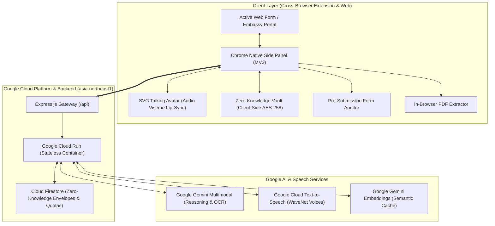

# 🌐 Telmy.ai: The Friendly AI Form-Filling Companion & Co-Pilot

<p align="center">
  
</p>

<p align="center">
  <strong>Transforming complex government paperwork, visa applications, and scholarship forms into an intuitive, conversational, and stress-free journey.</strong>
</p>

<p align="center">
  <a href="https://telmy.id" target="_blank">
    
  </a>
  <a href="https://github.com/arfabi/telmy.ai" target="_blank">
    
  </a>
</p>

<p align="center">
  
  
  
  
  
  
</p>

---

## 📌 Executive Summary (Untuk User Biasa, Judges, & Tech Leads)

Setiap tahun, jutaan orang di seluruh dunia mengalami frustrasi dan kecemasan saat mengisi formulir digital penting: visa imigrasi kedutaan, beasiswa luar negeri, apostille kementerian, hingga urusan perizinan usaha. Formulir ini dipenuhi istilah hukum berbelit (*"Apostille"*, *"Substituted Power of Attorney"*, *"Affidavit"*), format tanggal membingungkan, dan penalti diskualifikasi jika salah input satu huruf saja.

**Telmy.ai** adalah *AI Form-Filling Co-Pilot* yang mendampingi pengguna langsung di samping halaman web formulir (*Chrome Side Panel*) maupun dokumen PDF. Telmy menjelaskan arti kolom dalam bahasa santun sehari-hari, memberikan contoh isian realistis, mengaudit kelengkapan sebelum klik submit (*Traffic Light Auditor*), dan mengisikan data secara instan dengan **Zero-Knowledge Encrypted Vault**.

---

## 🏛️ System Architecture



---

## 🛠️ Google Technology Stack

Telmy.ai dibangun **100% Google AI & Google Cloud Native**:

| Google Technology | Produk / Model | Implementasi di Telmy.ai |
| :--- | :--- | :--- |
| **Generative AI** | **Google Gemini 2.5 / 3.5 Flash-Lite** | *Reasoning engine* untuk menyederhanakan bahasa hukum birokrasi, menjelaskan konteks kolom input, menjawab tanya-jawab pengguna, dan deteksi tipe dokumen. |
| **Multimodal Vision** | **Gemini Multimodal (Vision & OCR)** | Membaca dan mengekstrak entitas data dari KTP, Paspor, dan Ijazah secara instan tanpa menyimpan file fisik di server (*Zero-Retention Policy*). |
| **Voice Synthesis** | **Google Cloud WaveNet TTS** | Menghasilkan suara natural manusia beresolusi tinggi (24kHz) untuk 11 bahasa, yang menggerakkan animasi bibir avatar robot secara *real-time* (*audio viseme lip-sync*). |
| **Vector Embeddings** | **Google Gemini Embeddings** | Menghitung vektor kemiripan semantik istilah formulir untuk *Zero-Token Cache* sehingga respons instan dan hemat biaya token. |
| **Serverless Compute** | **Google Cloud Run** | Menjalankan *full-stack containerized app* (Express Backend + React Web Dashboard) di region `asia-northeast1` dengan auto-scaling otomatis. |
| **Database & Sync** | **Firebase Cloud Firestore** | Menyimpan *ciphertext envelope* terenkripsi AES-256, kuota user, riwayat formulir, dan metadata sesi perangkat. |
| **User Identity** | **Firebase Authentication** | 1-Click *Sign in with Google* yang menyinkronkan sesi akun secara mulus antara Web Dashboard dan Ekstensi Browser. |
| **Browser Standard** | **Chrome Extension Manifest V3** | Menggunakan Google Chrome Native Side Panel API (`chrome.sidePanel`), Service Worker background, dan pemenuhan regulasi privasi Google Chrome Web Store. |

---

## 🌟 Key Capabilities & Innovation Highlights

### 1. 🎙️ Real-time Voice Bot & Dynamic Lip-Sync Avatar
Bukan sekadar teks bantuan. Telmy dilengkapi bot suara interaktif yang menuturkan penjelasan formulir dengan Google Cloud WaveNet TTS. Frekuensi audio dianalisis via *Web Audio API (AnalyserNode)* untuk menggerakkan mulut avatar SVG secara presisi sesuai intonasi suara.

### 2. 🔐 Zero-Knowledge Client-Side Encrypted Vault (AES-256-GCM)
Keamanan adalah prioritas mutlak. Seluruh data profil pengguna (NIK, nomor paspor, alamat, riwayat pendidikan) dienkripsi di peramban pengguna menggunakan **AES-256-GCM** dengan derivasi kunci **PBKDF2** (100.000 iterasi) sebelum dikirim ke Cloud Firestore. Server Google Cloud Run maupun pengelola database **tidak pernah memegang kunci atau melihat data teks asli pengguna**.

### 3. 📄 Multimodal Document Ingestion (OCR to Vault)
Pengguna tidak perlu mengetik manual baris demi baris. Cukup upload foto KTP, scan paspor, atau ijazah (PDF/PNG/JPG). Gemini Multimodal akan mengekstrak entitas data relevan secara instan ke dalam kompartemen koper vault. File yang diunggah hanya diproses di memori RAM dan **segera dihapus permanen** (*Zero File Storage*).

### 4. 🚦 Pre-Submission Form Auditor (Traffic Light System)
Mencegah penolakan formulir sebelum terlambat. Telmy memindai seluruh kolom input yang sudah diisi pengguna dengan indikator warna:
* 🟢 **Hijau (Valid):** Format data tepat dan sesuai instruksi resmi.
* 🟡 **Kuning (Perhatian):** Peringatan (misal: nama mengandung gelar akademis yang dilarang di kolom paspor, atau format nomor telepon tanpa kode negara).
* 🔴 **Merah (Kritis):** Kolom wajib belum terisi atau salah format fatal.

### 5. 🌏 JAPAC 11 Multilingual Support
Mendukung 11 bahasa di kawasan Asia Pasifik dan global: Bahasa Indonesia, English, 日本語 (Japanese), 한국어 (Korean), 简体中文 (Simplified Chinese), 繁體中文 (Traditional Chinese), Tiếng Việt (Vietnamese), ไทย (Thai), हिन्दी (Hindi), Filipino, dan Bahasa Melayu.

---

## 🚀 Panduan Instalasi & Menjalankan Lokal

### Prasyarat
* **Node.js** v20+ atau v22+
* **Google Chrome** (versi 114+ dengan dukungan Side Panel)
* **Google Gemini API Key** (Dapatkan di [Google AI Studio](https://aistudio.google.com/))

### 1. Menjalankan Backend
```bash
# 1. Pindah ke direktori backend
cd backend

# 2. Install dependencies
npm install

# 3. Buat file .env dari template
cp ../.env.example .env
```

Pastikan variabel environment di `backend/.env` terisi:
```env
PORT=8080
NODE_ENV=development
AI_PROVIDER=gemini
GEMINI_API_KEY=your_gemini_api_key_here
GEMINI_MODEL=gemini-2.5-flash-lite
GOOGLE_TTS_API_KEY=your_gemini_api_key_here
EXPLAIN_STRATEGY=AI_FIRST
```

Jalankan server backend:
```bash
npm run dev
# Server aktif di http://localhost:8080
# Cek kesehatan API di http://localhost:8080/health
```

### 2. Menjalankan Frontend Web Dashboard
Buka terminal baru:
```bash
cd frontend
npm install
npm run dev
# Dashboard & Landing Page aktif di http://localhost:5173
```

### 3. Memasang Ekstensi di Browser (Chrome / Edge / Opera / Brave)
1. Buka browser dan ketik alamat: `chrome://extensions/` (atau `edge://extensions/`).
2. Aktifkan **Developer mode** (toggle di pojok kanan atas).
3. Klik tombol **Load unpacked** (pojok kiri atas).
4. Pilih folder `extension/` dari direktori repository ini.
5. Telmy siap digunakan! Klik ikon Telmy di toolbar atau tekan pintasan keyboard **`Alt + G`**.

---

## ☁️ Deployment ke Google Cloud Run

Project ini menggunakan arsitektur **Unified Multi-Stage Dockerfile** di root project. Frontend React Vite dikompilasi secara otomatis, lalu disajikan langsung melalui Express server dalam 1 container yang sama:

```bash
# Deploy langsung dari root project ke Cloud Run
gcloud run deploy telmy-backend \
  --source . \
  --region asia-northeast1 \
  --allow-unauthenticated \
  --set-env-vars GEMINI_API_KEY="AIzaSy...",FIREBASE_PROJECT_ID="guidemeto-bdf36",EXPLAIN_STRATEGY="AI_FIRST",GOOGLE_TTS_REFERER="https://telmy.id/"
```

---

## 🏆 Kriteria Penilaian Hackathon (Judges Evaluation Matrix)

| Kriteria Hackathon | Bukti Implementasi pada Telmy.ai |
| :--- | :--- |
| **Pemanfaatan Google Cloud & AI** | Mengintegrasikan 6 layanan Google: Gemini 2.5 Flash-Lite, Gemini Multimodal Vision, Gemini Embeddings, Google Cloud WaveNet TTS, Firebase Firestore, dan Google Cloud Run. |
| **Dampak Sosial & Inklusivitas** | Membantu jutaan pelajar beasiswa, pekerja migran, lansia, dan disabilitas dalam mengatasi ketakutan birokrasi digital melalui navigasi suara dan bahasa ibu mereka. |
| **Keamanan & Etika AI (Privacy First)** | Arsitektur Zero-Knowledge Encryption (kunci tidak disimpan di cloud) dan Zero Document Retention (file fisik tidak pernah disimpan di disk). |
| **Kematangan Produk (Production Ready)** | Tersedia ekstensi siap pasang (Chrome Web Store MV3 compliant), web platform lengkap dengan dashboard, autentikasi Firebase, dan simulasi pembayaran Mayar.id. |

---

## 📄 Lisensi & Kontributor
Dibuat dengan ❤️ oleh **Telmy.ai Team** untuk **Google AI Hackathon 2026** (Hack2skill).  
*Empowering digital accessibility, cross-border paperwork, and barrier-free opportunities for all.*
