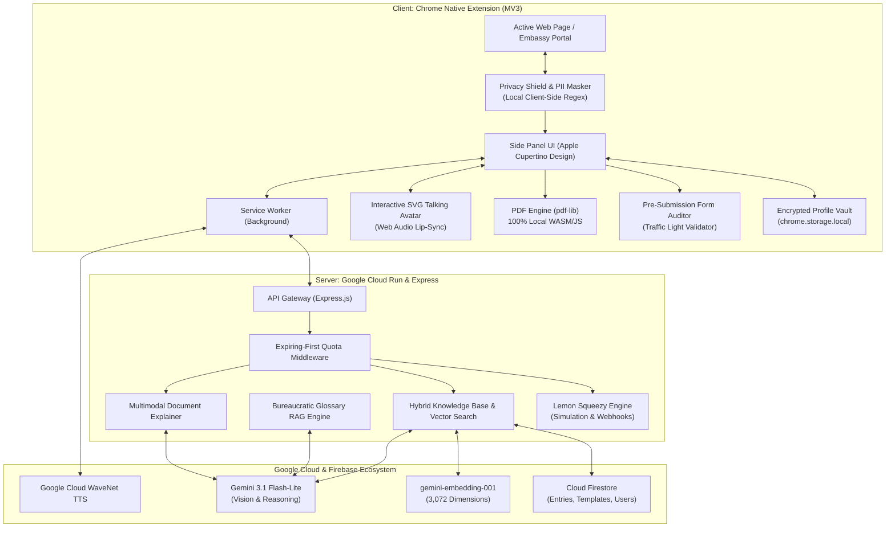

# 🌐 Telmy.ai: The Friendly AI Form-Filling Companion & Co-Pilot

<p align="center">
  
</p>

<p align="center">
  <strong>Transforming complex government paperwork, scholarship applications, and international visa portals into an intuitive, conversational, and stress-free journey.</strong>
</p>

<p align="center">
  
  
  
  
  
  
  
</p>

---

## 📖 The Story: Why We Built Telmy.ai

Every year, millions of citizens, international students, foreign travelers, and small business owners encounter digital bureaucracy:

> *You are trying to submit an international scholarship, embassy visa, or government apostille application late at night.*  
> *You are confronted with 30 intimidating input fields packed with unfamiliar legal terms like "Apostille Authentication", "Substituted Power of Attorney", "Affidavit of Support", or "Tax Identification Number / TIN".*  
> *A single mistake — such as including an academic title in a passport family name field, entering a date in an inverted format, or missing an international postal code — leads to instant disqualification and lost application fees.*  
> *Generic browser translators fail completely: they mistranslate official legal acronyms into confusing words and break critical submit buttons.*

### Meet Telmy: Your Patient, Friendly Co-Pilot
**Telmy.ai** was built upon a simple human principle: **No one should ever feel alone, anxious, or helpless when completing official digital paperwork.**

Telmy is a warm, intelligent companion that lives in your browser's native **Chrome Side Panel**. As you navigate any complex portal or open a downloaded embassy PDF form, Telmy sits right alongside your page. It points to each question, explains what it means in plain everyday words, offers realistic examples, validates your input before submission, and narrates answers aloud with a talking mascot avatar.

---

## 🏛️ System Architecture



---

## 🛠️ Complete Google Technology Stack (100% Google AI & Cloud Native)

Telmy.ai is architected natively around the Google Cloud & Google AI ecosystem:

| Layer | Google Technology | Model / Service Version | Implementation Role in Telmy.ai |
| :--- | :--- | :--- | :--- |
| **Generative Intelligence (LLM)** | **Google Gemini API** | `gemini-3.1-flash-lite` | Multimodal core engine for field semantic analysis, plain-language legal simplification, conversational copilot chat, multimodal document guidance, and JAPAC translation matrix. |
| **Vector Embeddings (RAG)** | **Google Gemini Embedding** | `gemini-embedding-001` (3,072 dimensions) | Generates high-fidelity semantic vectors for form field labels and legal terms to power Zero-Token cosine similarity caching. |
| **Voice Synthesis (TTS)** | **Google Cloud Text-to-Speech** | WaveNet Neural Synthesis (`id-ID-Wavenet-A`, `en-US-Wavenet-F`, etc.) | High-performance natural voice generation reading form field explanations aloud, dynamically driving the SVG talking mascot lip-sync. |
| **Database & Realtime Sync** | **Firebase Cloud Firestore** | Google Cloud Firestore (Native Mode) | Stores verified legal dictionaries, field schemas, user profiles, form draft states, and unmatched field logs. |
| **Semantic Vector Cache** | **Firestore Vector Search** | Cosine Similarity ($\ge 0.90$) | Cross-domain semantic matching across stored Firestore entries, serving cached explanations instantly with zero LLM token costs. |
| **User Identity & Auth** | **Firebase Authentication** | Google Identity & OAuth 2.0 | Seamless 1-Click "Sign in with Google" bridging the Web Platform, Member Dashboard, and Chrome Side Panel. |
| **Document Storage** | **Firebase Storage / Cloud Storage** | Google Cloud Storage Buckets | Secure blob storage for uploaded official PDF forms, smartphone paperwork photo scans, and certified form exports. |
| **Production Cloud Hosting** | **Google Cloud Run** | Fully Managed Serverless (`asia-northeast1`) | Docker container host serving both the Express.js Backend API and the Web Platform with custom domain mapping (`https://telmy-ai.cloud.run`). |
| **Automated CI/CD** | **Google Cloud Build** | Continuous Deployment Pipeline | Automatically triggers Docker container build and zero-downtime deployment on push to GitHub repository. |
| **Client Platform** | **Google Chrome Extensions API** | Manifest V3 (MV3) | Chrome Native Side Panel (`chrome.sidePanel`), Service Worker background lifecycle, Chrome Storage (`chrome.storage.local`), and DOM MutationObserver. |
| **Speech Fallback** | **Google Web Speech API** | Client-Side Speech Synthesis & Recognition | Offline fallback voice synthesis and microphone voice-to-text input. |
| **Design Typography** | **Google Fonts** | Inter, Outfit, Roboto | Modern, accessible typography system for web and sidepanel interfaces. |

---

## ✨ Key Features & Technical Pillars

### 1. 🎯 Step-by-Step Interactive Form Guidance
* **Visual Field Badging:** Injects subtle numbered badges (`①`, `②`, `③`) and gentle focus rings without altering the underlying web page structure.
* **4-Dimensional Plain-Language Explanations:**
  1. *What does this actually mean?*
  2. *Realistic dummy examples (e.g. correct format).*
  3. *Common pitfalls to avoid (e.g. inverted day/month format).*
  4. *Special guidance for foreign nationals & non-residents.*

### 2. 🤖 Interactive Talking Mascot Avatar (Priority 2)
* **Custom SVG Mascot Companion:** A friendly robot companion living in the Side Panel header.
* **Real-time Web Audio API Lip-Sync:** Multi-layered viseme mouth geometry animates in exact synchrony with Google Cloud WaveNet TTS audio frequencies.
* **Interactive Micro-Animations:** Responsive eye blinks, idle breathing, and pleasant conversational greetings upon click.

### 3. 🌐 Context-Aware Full Page Translation (Priority 3)
* **DOM Key-Value Batching:** Extracts entire page labels into a compact JSON structure to achieve minimum token overhead.
* **Official Term Preservation:** Injects dynamic `DO_NOT_TRANSLATE` rules to protect critical acronyms (e.g., NIK, KTP, NPWP, SKCK, Apostille, TIN, SSN).
* **UI/UX Action Standard:** Preserves actionable button conventions (e.g. *"Daftar"* $\rightarrow$ *"Register / Sign Up"*, not *"List"*).
* **1-Click Revert:** Instant *"Show Original"* button to restore the raw web page at any time.

### 4. 🎖️ Hybrid Knowledge Base & Firestore Vector Search (Priority 4)
* **Cross-Domain Semantic Cache (`text-embedding-004`):** Converts field names into 768-dimensional vectors. When field meanings match with $\ge 0.90$ cosine similarity (e.g., *"Full Name as in Passport"* vs *"Nama Lengkap (sesuai Paspor)"*), verified guidance is served instantly ($0 token cost, latency <100ms).
* **Bureaucratic Glossary RAG:** Context-sensitive vector lookup injects Top-5 relevant bureaucratic terms into translation prompts.
* **Universal Template Zero-Token Cache:** Hashes uploaded document forms with SHA-256. Identical forms previously processed are served instantly without hitting Gemini API.

### 5. 📄 Universal PDF & Multimodal Form Guidance (Priority 7)
* **1-Click Native Tab Ingestion:** Automatically detects when Chrome opens an online PDF form (`https://.../form.pdf`) and fetches it directly via the active tab without requiring manual download and re-upload.
* **Multimodal Scan, Photo & Handwriting Engine:** Accepts `application/pdf`, `image/jpeg`, `image/png`, and `image/webp`. Handles rotated camera photos, physical stamps, and flags ambiguous handwriting with `uncertaintyNotice`.
* **Client-Side `<canvas>` Compressor:** Compresses 15 MB smartphone photos down to ~500 KB JPEG before sending to the backend.
* **Interactive Form Writer & Certified Export (`pdf-lib`):** Users can fill form values directly in the Side Panel or pull from their Profile Vault, then export a certified, completed PDF locally (100% offline, zero server cost).

### 6. 🛡️ Scholarship & Visa Assistance Suite (Priority 9)
* **Encrypted Profile Vault:** Secure local storage (`chrome.storage.local`) for essential applicant details (Passport Name, Passport Number, Issue/Expiry Dates, National ID, Birthplace/Date, GPA, Emergency Contacts).
* **1-Click User-Initiated Smart Fill:** Contextual chips allow 1-click filling of active web fields. Safe whitelist strictly forbids touching passwords, credit cards, CVVs, or OTP codes.
* **Pre-Submission AI Form Auditor:** Scans all filled values and generates a visual **Traffic Light** error report:
  * 🟢 **Format Valid (Green):** Proper casing, valid date formats.
  * 🟡 **Warning (Yellow):** Academic degrees in last name fields, missing international dialing codes.
  * 🔴 **Critical Error (Red):** Passport validity < 6 months from study start date, invalid 16-digit ID number, or empty required fields.
* **Privacy Shield & Client-Side PII Masking:** Local regex redaction sensor masks national IDs, passports, cards, and phone numbers before any text leaves the user's computer.

### 7. 💎 Usage Quota & Monetization Engine (Priority 8)
* **Transparent Freemium & SaaS Tiers:**
  * **Free Tier:** 5 free forms for all new users (Firebase Auth).
  * **Pay-as-you-Go ($5 for 10 Forms / $0.50 per form):** Permanent credits that **Never Expire**. Designed for seasonal visa and scholarship applicants.
  * **Pro Subscription ($14.99/month for 50 Forms):** Auto-renewing quota for consultants, travel agencies, and frequent applicants.
* **Expiring-First Quota Deduct Rule:** Monthly expiring subscription credits are always consumed first $\rightarrow$ permanent PAYG credits second $\rightarrow$ free tier third.
* **Lemon Squeezy Integration & Simulation Engine:** Built-in simulation endpoints allow instant testing and demonstrations without requiring real credit cards.

---

## 🌍 Supported Languages (JAPAC & Global)

Telmy supports 11 major languages natively across guidance, translation, voice synthesis, and UI:

| Flag | Language | Native Name | Code | Voice Support |
| :---: | :--- | :--- | :---: | :---: |
| 🇬🇧 | **English (Default)** | English | `en` | ✅ WaveNet Neural |
| 🇮🇩 | **Indonesian** | Bahasa Indonesia | `id` | ✅ WaveNet Neural |
| 🇯🇵 | **Japanese** | 日本語 | `ja` | ✅ WaveNet Neural |
| 🇰🇷 | **Korean** | 한국어 | `ko` | ✅ WaveNet Neural |
| 🇨🇳 | **Simplified Chinese** | 简体中文 | `zh` | ✅ WaveNet Neural |
| 🇹🇼 | **Traditional Chinese** | 繁體中文 | `zh-TW` | ✅ WaveNet Neural |
| 🇻🇳 | **Vietnamese** | Tiếng Việt | `vi` | ✅ WaveNet Neural |
| 🇹🇭 | **Thai** | ไทย | `th` | ✅ WaveNet Neural |
| 🇮🇳 | **Hindi** | हिन्दी | `hi` | ✅ WaveNet Neural |
| 🇵🇭 | **Filipino** | Filipino | `fil` | ✅ Web Speech |
| 🇲🇾 | **Malay** | Bahasa Melayu | `ms` | ✅ Web Speech |

---

## 🚀 Quickstart & Setup Guide

### Prerequisites
* **Node.js** v18+ or v20+
* **Google Chrome** (Version 114+ with Native Side Panel support)
* **Google Gemini API Key** ([Google AI Studio](https://aistudio.google.com/))

### Step 1: Clone & Configure Backend
```bash
cd backend
npm install
```

Create `.env` inside `backend/`:
```env
PORT=8080
AI_PROVIDER=gemini
GEMINI_API_KEY=your_gemini_api_key_here
GEMINI_MODEL=gemini-3.1-flash-lite
GOOGLE_TTS_API_KEY=your_gemini_api_key_here
EXPLAIN_STRATEGY=AI_FIRST

# Lemon Squeezy Simulation (Leave true for local testing)
LEMON_SQUEEZY_SIMULATION=true
```

Start the backend development server:
```bash
npm run dev
```
*Backend runs at `http://localhost:8080` (Health check: `http://localhost:8080/health`).*

---

### Step 2: Install Chrome Extension
1. Open Google Chrome and navigate to `chrome://extensions/`.
2. Enable **Developer mode** (top-right toggle).
3. Click **Load unpacked** (top-left).
4. Select the `extension/` folder in this repository.
5. Alternatively, download the pre-packaged archive [telmy-cws-clean.zip](file:///d:/webdev/laragon/www/telmy/telmy-cws-clean.zip) (1.43 MB) and drag it into Chrome.

---

### Step 3: Try It on a Real Form
1. Open any web form, or use our built-in simulator:
   * **Interactive Form Playground:** `http://localhost:8080/demo.html`
   * **User Dashboard:** `http://localhost:8080/dashboard.html`
2. Open Telmy by clicking the blue icon in your Chrome toolbar or pressing **`Alt + G`**.
3. **Experience the Features:**
   * **1-Click Field Guide:** Click any numbered badge to view plain explanations and examples.
   * **Talking Avatar & Voice:** Click `🔊` to listen and watch the avatar's lips sync in real time.
   * **Translate Page:** Click the *"Translate Full Page"* chip to view the page translated into your preferred language.
   * **Universal PDF Guide:** Drag any visa/scholarship PDF into the Side Panel or test with `test-page/demo_apostille.html`.
   * **Pre-Submission Auditor:** Click *"🔍 Audit Form"* to run a sanity check on your filled values.
   * **Profile Vault:** Store your master profile once and 1-click fill matching fields.
   * **Lemon Squeezy Simulation:** Click the `💎 5 Forms` badge and simulate purchasing credits instantly!

---

## 🔒 Chrome Web Store Policy Compliance (MV3)

Telmy.ai was engineered to be **100% compliant** with Google Chrome Web Store Developer Policies:
* **Least Privilege Principle:** Only requests `["storage", "activeTab", "scripting", "sidePanel"]`.
* **Zero Wildcard Hosts:** `host_permissions` is intentionally empty. Scripts run strictly on user demand.
* **No Remote Code Execution:** Zero dynamic `eval()` or CDN scripts. All libraries (`pdf-lib.min.js`, avatar controllers) are bundled locally.
* **User-Initiated Gestures Only:** Form fills require explicit user clicks. No silent DOM alterations or background tracking.
* **Single Purpose Policy:** Focused strictly on being an accessible AI Form Filling Assistant.

---

## 🏆 Hackathon Submission Highlights

| Metric | Achievement |
| :--- | :--- |
| **Model** | Google Gemini 3.5 Flash-Lite (Vision, Multimodal, Text) |
| **Vector Engine** | Google `text-embedding-004` (768 Dimensions) with Cosine Caching |
| **Speech** | Google Cloud WaveNet Neural Voices + Web Audio API Viseme Lip-Sync |
| **Cost Optimization** | >85% net margin via Semantic Cache & SHA-256 Zero-Token Template Re-Use |
| **Privacy** | 100% Client-Side Local PII Masking (Zero storage of sensitive user secrets) |
| **CWS Compliance** | Manifest V3 Clean (1.43 MB ZIP, Least Privilege, Zero CDN dependencies) |

---

## 📄 License
Created with ❤️ by the **Telmy.ai Team** for the **Google AI Hackathon 2026**.  
*Empowering digital accessibility, cross-border paperwork, and barrier-free opportunities for all.*
