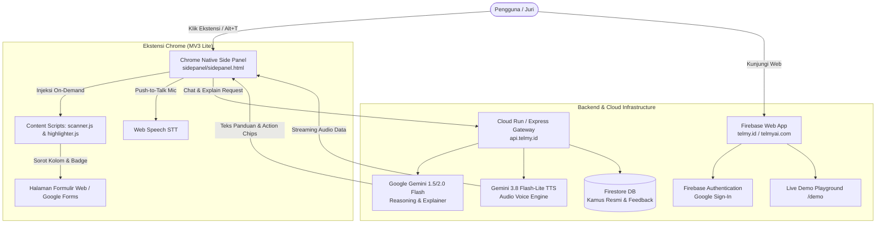

# PRD & Technical Plan: Telmy.ai (AI Form Guide & Conversational Co-Pilot)

**Status:** PRD v2.1 (Google AI Hackathon & Chrome Web Store Fast-Track Edition)  
**Platform:** Chrome Extension Manifest V3 (`chrome.sidePanel`) + Firebase (Hosting, Firestore, Functions/Cloud Run) + 100% Google Gemini AI + Gemini 3.8 Flash-Lite TTS  
**Domain Resmi:** `telmy.id` (primer) / `telmyai.com`  
**Target Submission:** Google AI Hackathon (Kepatuhan 100% Ekosistem Google) & Chrome Web Store (< 10 Hari)  

---

## 1. Ringkasan Eksekutif & Visi Produk

**Telmy.ai** adalah asisten formulir cerdas (*multimodal AI form guide & browser co-pilot*) yang memandu masyarakat umum maupun warga negara asing (WNA) dalam memahami, menavigasi, dan menyelesaikan pengisian formulir digital pelayanan publik, portal perizinan (seperti Apostille, OSS-RBA, Coretax, Imigrasi), hingga Google Forms secara mudah, aman, ramah privasi, dan multibahasa.

Pada versi v2.1, arsitektur Telmy diselaraskan 100% dengan standar **Google AI Ecosystem & Firebase** guna memenuhi kriteria penilaian Google AI Hackathon (*Technical Merit*, *Problem Alignment & Impact*), serta menerapkan strategi **Dual-Build** untuk percepatan rilis di Chrome Web Store:
1. **100% Google AI Native:** Seluruh penalaran form, kamus konteks, dan obrolan ditangani oleh **Google Gemini (Gemini 1.5/2.0 Flash)**.
2. **Audio Voice Engine Resmi Google:** Migrasi suara penuh dari pihak ketiga ke **Gemini 3.8 Flash-Lite TTS (Preview)** dan Google Cloud TTS dengan fallback browser Web Speech API.
3. **Privasi Ketat & Push-to-Talk:** Menghapus wake-word atau mikrofon *always-listening*. Mikrofon hanya aktif saat pengguna secara sadar mengklik ikon mikrofon di panel samping (*Push-to-Talk*).
4. **Chrome Native Side Panel (`chrome.sidePanel`):** Panel samping native browser yang responsif, tidak merusak CSS website target, dan menjalankan mikrofon/audio di origin ekstensi yang aman.
5. **Platform Web Terpadu (Firebase):** Landing page, live demo playground, autentikasi Google 1-klik, dan dashboard pengguna di `telmy.id` / `telmyai.com`.

---

## 2. Kepatuhan Aturan Hackathon & Strategi Dual-Build

### A. Kepatuhan Aturan Google Hackathon
* **Anti-Diskualifikasi:** Menghapus seluruh dependensi ke LLM non-Google (GLM-5.3) dan voice engine pihak ketiga (ElevenLabs). Telmy 100% ditenagai oleh Google Gemini & Google Cloud TTS.
* **Pengukuran Dampak Sosial (25% Kriteria):** Menyajikan metrik terukur sebelum vs sesudah (pengurangan waktu pengisian formulir dari 25 menit menjadi 5 menit dan pengurangan tingkat kesalahan data).

### B. Strategi Dual-Build (Chrome Web Store vs Hackathon Demo)
| Aspek | Build Lite (Chrome Web Store v1) | Build Full (Hackathon Demo & Juri) |
| :--- | :--- | :--- |
| **Distribusi** | Chrome Web Store (Visibilitas: *Unlisted*) | File ZIP *Load Unpacked* di `telmy.id/download` |
| **Izin Manifest** | Minimal: `activeTab`, `scripting`, `sidePanel`, `storage` | Izin yang sama + flag demo lokal |
| **Host Permissions** | Sempit: `https://api.telmy.id/*`, `https://telmyai.com/*` | Sempit + izin localhost |
| **Injeksi Skrip** | *On-demand* (saat klik ikon / shortcut `Alt+T`) | *On-demand* & auto-load di halaman demo |
| **Otomasi Klik** | **Ditahan** (murni panduan visual: spotlight, badge, scroll) | Diaktifkan dengan tombol konfirmasi di halaman simulasi |
| **Waktu Rilis** | Diajukan pada Hari ke-4 untuk lolos tepat waktu | Disertakan di submission form & video demo 3 menit |

---

## 3. Spesifikasi Fitur Utama

### 3.1. Mesin AI Penalaran & Suara (Gemini & Gemini TTS)

#### A. Deskripsi Fungsional
* **Form Intelligence (Gemini 1.5 / 2.0 Flash):** Mengekstrak metadata struktur kolom formulir tanpa membaca data pribadi pengguna. Menghasilkan arti kolom, instruksi pengisian resmi, contoh isian fiktif yang realistis, dan catatan khusus paspor bagi WNA.
* **Voice Guidance (Gemini 3.8 Flash-Lite TTS Preview):** Menghasilkan streaming suara alami berbahasa Indonesia dan multibahasa dengan efisiensi biaya dan latensi ultra-rendah.
  * *SKU Input Teks:* `6D6B-51EE-87C4` ($0,50 per 1M token)
  * *SKU Output Audio:* `676E-5101-0A30` ($6,00 per 1M token audio)
* **Kamus Istilah Resmi (Firestore):** Memprioritaskan data definisi baku untuk portal birokrasi utama (Apostille, Paspor, OSS, NPWP).

#### B. Interaksi Suara Push-to-Talk (Ramah Privasi)
* **Murni Push-to-Talk:** Pengguna menekan ikon mikrofon di Side Panel untuk mulai berbicara. Tidak ada perekaman latar belakang atau *always-listening*.
* **Live Transcript Streaming:** Ucapan pengguna ditranskripsikan langsung ke dalam bubble obrolan Side Panel.
* **Fallback Cerdas:** Jika koneksi API suara backend terkendala, otomatis menggunakan Web Speech API browser (`SpeechSynthesis`).

---

### 3.2. Chrome Native Side Panel (`chrome.sidePanel`) & Antarmuka Obrolan

#### A. Deskripsi Fungsional
* **Tab Navigasi Terintegrasi:**
  * `💬 Obrolan (Chat):` Aliran percakapan dua arah antara pengguna dan Telmy Co-Pilot dengan kartu aksi interaktif (*action chips*).
  * `📋 Kolom (Fields):` Daftar seluruh kolom formulir terdeteksi, lengkap dengan status terisi dan penunjuk navigasi stepper (*Sebelumnya / Berikutnya*).
  * `📌 Ringkasan (Overview):` Ringkasan formulir, estimasi durasi pengisian, dan daftar berkas/dokumen yang wajib disiapkan.
* **Dukungan 5 Bahasa Instan:** Pengalihan bahasa instan langsung dari header panel tanpa reload (🇮🇩 ID, 🇬🇧 EN, 🇨🇳 ZH, 🇯🇵 JA, 🇰🇷 KO).
* **Shortcut Cepat:** Dapat dibuka dan ditutup kapan saja dengan kombinasi tombol **`Alt + G`**.

---

### 3.3. Deteksi Formulir & Penandaan Visual (Highlighting)

#### A. Deskripsi Fungsional
* **Scanner Universal:** Mendeteksi elemen input standar HTML5 (`input`, `select`, `textarea`) serta komponen modern Google Forms dan widget ARIA (`[role="radiogroup"]`, `[role="textbox"]`, `[role="combobox"]`).
* **Lencana Nomor Neon:** Menempelkan nomor urut pemandu di samping setiap judul pertanyaan.
* **Visual Spotlight:** Menyorot kolom yang sedang aktif dengan efek cincin fokus neon (`gmt-highlighted-field`) dan auto-scroll ke posisi elemen tersebut.
* **MutationObserver:** Memindai ulang secara otomatis jika ada formulir baru yang dimuat secara dinamis oleh JavaScript framework (React, Vue, SPA, form wizard).

---

### 3.4. Platform Web Firebase (`telmy.id` / `telmyai.com`)

#### A. Komponen Halaman Web
1. **Landing Page (`/`):** Hero section, nilai manfaat, video demo 3 menit, perbandingan dampak sebelum vs sesudah, dan 4 pilar fitur.
2. **Live Demo Playground (`/demo`):** Formulir simulasi terintegrasi (contoh: Simulasi Apostille Kemenkumham) agar juri dapat menguji ekstensi dalam 1 klik tanpa mencari form eksternal.
3. **Panduan Unduh (`/download`):** Tautan resmi Chrome Web Store + link download ZIP *Load Unpacked* untuk tim penguji/juri hackathon.
4. **Kebijakan Privasi (`/privacy`):** Menegaskan prinsip *Privacy-First* (hanya memproses metadata form, tidak menyimpan data sensitif pengguna).
5. **Dashboard Pengguna (`/dashboard`):** Firebase Authentication (Google 1-Click Login), statistik pemakaian, dan tombol koneksi ke ekstensi via `externally_connectable`.

---

## 4. Arsitektur Teknis Sistem



---

## 5. Rencana Pelaksanaan & Prioritas Kerja (10 Hari)

### 🥇 Prioritas 1: Web MVP Live di Firebase (Hari 1 - 3)
- Setup project Firebase Hosting, Firestore, dan integrasi domain `telmy.id` / `telmyai.com`.
- Bangun Landing Page modern, Halaman Live Demo Playground (`/demo`), Halaman Privasi (`/privacy`), dan Halaman Unduh (`/download`).

### 🥈 Prioritas 2: Dashboard & Google Auth Connect (Hari 3 - 4)
- Integrasi Firebase Google Sign-In 1-klik di dashboard.
- Hubungkan ekstensi ke dashboard web via `externally_connectable` tanpa izin `identity`.

### 🥉 Prioritas 3: Ekstensi Lite & Submit Chrome Web Store (Hari 4 - 5)
- Migrasi voice gateway ke Gemini Flash-Lite TTS.
- Migrasi panel ke Chrome Native Side Panel (`chrome.sidePanel`) dengan Push-to-Talk mic.
- Bersihkan Manifest V3 (hapus `<all_urls>`, gunakan `activeTab` + `scripting`).
- Submit ke Chrome Web Store dengan mode **Unlisted**.

### 🏅 Prioritas 4: Materi Submission Hackathon (Hari 6 - 10)
- Rekam dan edit video demonstrasi 3 menit (fokus pada dampak sosial dan teknologi Google Gemini).
- Siapkan Pitch Deck PDF (arsitektur teknis, target pengguna, dan skalabilitas).
- Siapkan paket ZIP *Load Unpacked* untuk juri hackathon di `telmy.id/download`.
- Finalisasi formulir submission Google AI Hackathon.

---

## 6. Parameter Model & Konfigurasi Lingkungan

```env
# Backend Environment (.env)
PORT=8080
GEMINI_API_KEY=your-gemini-api-key
GEMINI_MODEL=gemini-1.5-flash
GEMINI_TTS_MODEL=gemini-3.8-flash-lite-tts
EXPLAIN_STRATEGY=AI_FIRST

# Firebase Configuration
FIREBASE_PROJECT_ID=telmy-ai
FIREBASE_REGION=asia-southeast2
DOMAIN_PRIMARY=https://telmy.id
DOMAIN_SECONDARY=https://telmyai.com
```