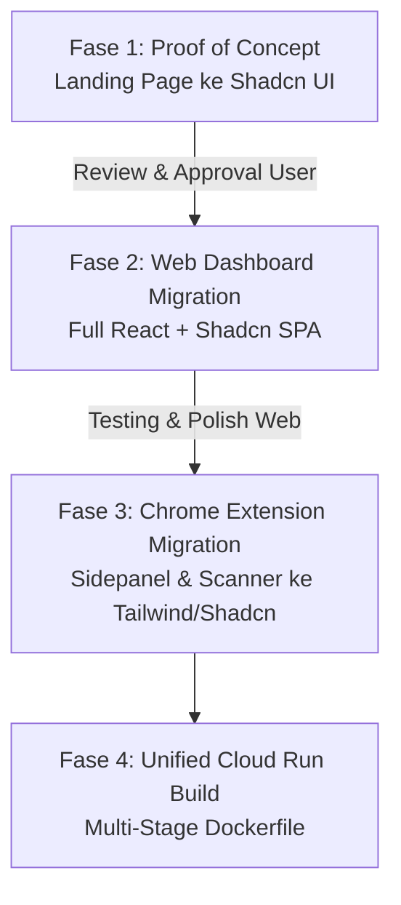

# 🚀 PLAN V5: Enterprise-Grade Migration to React + Shadcn UI (Telmy.ai)

> **Status:** APPROVED FOR PLANNING & PHASE 1 EXECUTION  
> **Target Standard:** Enterprise SaaS Grade (Apple Cupertino & Linear/Vercel Polish) — *Bukan Side-Project/Hobbyist Quality*  
> **Strategi Eksekusi:** Terpisah & Bertahap (**Web Platform Dahulu** -> **Uji Landing Page Pertama Kali** -> **Dashboard** -> **Ekstensi Chrome**)

---

## 🏛️ 1. Standar Kualitas Desain (Enterprise-Grade UI Standard)

Aplikasi Telmy.ai akan ditingkatkan dari Vanilla CSS ke arsitektur **React + Vite + Tailwind CSS + Shadcn UI** dengan standar industri kelas dunia:

| Aspek | Standar Hobbyist (Dihindari ❌) | Standar Enterprise Telmy.ai (Target Kita ✅) |
|---|---|---|
| **Komponen UI** | HTML mentah, tombol polos, styling ad-hoc inline | **Radix UI Primitives (Shadcn UI)**: 100% accessible (WAI-ARIA), keyboard navigasi (`Tab`, `Esc`), focus rings halus. |
| **Palet Warna & Tokens** | Warna generic (pure blue `#0000ff`, pure black `#000`) | **Tailwind Zinc/Slate Matrix**: HSL curated palette, dark/light mode harmonis, border halus `border-border/40`. |
| **Tipografi** | Font browser default Arial/Times | **Geist / Plus Jakarta Sans / SF Pro**: Hierarki ukuran ketat, tabular numbers untuk kuota/angka. |
| **Mikro-Interaksi** | Hover kaku atau tanpa animasi | **Spring Physics (Framer Motion / Tailwind Animate)**: Smooth drawer slide, dialog fade-in, skeleton loader, ripple click feedback. |
| **Data State** | Manipulasi `document.getElementById` manual | **Reaktif Otomatis**: React Query / React Context / Hooks sinkron real-time dengan Firestore. |
| **Responsivitas** | Tampilan mobile berantakan | **Fluid Mobile-First Layout**: Sheet drawer untuk mobile navigation, adaptive grid layout. |

---

## 🛠️ 2. Tech Stack Baru yang Digunakan

* **Core Framework**: React 18 / 19 + TypeScript / modern ESM
* **Build Tool**: Vite (Lightning-fast HMR & optimized production chunking)
* **CSS Engine**: Tailwind CSS v3.4+ dengan CSS Variables
* **Component Library**: **Shadcn UI** (Button, Dialog, Sheet, DropdownMenu, Tabs, Card, Table, Badge, Tooltip, Sonner Toast, Progress, Avatar)
* **Iconography**: **Lucide React** (Ikon vektor modern bergaris konsisten 1.5px–2px stroke)
* **Animasi**: `tailwindcss-animate` + `framer-motion` (opsional untuk fluid hero effects)
* **Backend Serving**: Tetap disajikan oleh Node.js Express di Google Cloud Run (`https://telmy-ai.cloud.run`) dalam satu kesatuan URL (*Single-URL Unified Deployment*).

---

## 🗺️ 3. Roadmap Eksekusi Terpisah (Phase by Phase)



---

## 🎯 FASE 1: PROOF OF CONCEPT — LANDING PAGE (PRIORITAS PERTAMA)

Sebelum menyentuh dashboard yang rumit dan ekstensi Chrome, **Landing Page (`index.html`) akan di-rewrite pertama kali ke React + Shadcn UI**. 

### Tujuan Fase 1:
Memberikan demonstrasi visual langsung kepada Anda untuk membuktikan kualitas UI tingkat industri sebelum melangkah ke fitur yang lain.

### Rincian Pengerjaan Landing Page:
1. **Setup Pondasi Frontend Vite**:
   - Inisialisasi arsitektur React di root/subfolder yang terintegrasi rapi dengan backend.
   - Konfigurasi Tailwind CSS, font `Plus Jakarta Sans`, dan setup CLI `shadcn-ui`.
2. **Hero Section (Apple-Grade Interactive Preview)**:
   - Typography tegas dengan gradient text halus.
   - Mockup animasi interaktif form-filler: simulasi ekstensi menjelaskan kolom paspor/visa secara live.
   - Dual Call-to-Action: *"Install Chrome Extension"* (Primary) & *"Try Live Interactive Demo"* (Outline).
3. **Bento Grid Features Showcase**:
   - Grid kartu bergaya Vercel/Apple dengan border glow dan glassmorphism.
   - Visualisasi: Voice WaveNet player, Semantic Zero-Token Cache, Multi-language Matrix (11 bahasa).
4. **Interactive Language Switcher & Testimonials**:
   - Dropdown menu Shadcn untuk pergantian 11 bahasa Asia-Pasifik secara instan.
5. **Trust & Security Badges**:
   - Verified Google Cloud Run & Firebase security badges.
   - Client-side encryption assurance indicators.
6. **Mobile Responsive Sheet Navigation**:
   - Drawer geser samping yang mulus saat dibuka di layar smartphone.

> **Checkpoint Fase 1:**  
> Landing page dijalankan secara lokal/live preview. Anda melihat dan mereview langsung kualitas estetika, kerapian, dan transisinya. Jika Anda sudah puas dan menyetujuinya, baru kita melangkah ke Fase 2.

---

## 📊 FASE 2: FULL MIGRATION WEB DASHBOARD (`/dashboard` & `/connect`)

Setelah kualitas UI di Landing Page disetujui, kita mentransformasi `dashboard.html` (2.700 baris vanilla) menjadi **Modern React SaaS Dashboard**:

### Rincian Pengerjaan Dashboard:
1. **Pemisahan Komponen Modular**:
   - `components/dashboard/Sidebar.tsx`: Navigasi kiri collapsible dengan active states dan badge kuota.
   - `components/dashboard/Header.tsx`: Profil pengguna, avatar, status sync ekstensi, tombol dark/light mode.
   - `components/dashboard/QuotaCard.tsx`: Indikator kredit tersisa dengan progress bar animasi dan tombol upgrade.
   - `components/dashboard/FormHistoryTable.tsx`: Tabel riwayat pengisian formulir menggunakan `Table` Shadcn dengan pagination dan filter status.
   - `components/dashboard/SettingsTab.tsx`: Konfigurasi bahasa default, suara WaveNet, dan AI reasoning strategy.
2. **State Management & Firebase Integration**:
   - Hook kustom `useAuth()` yang memantau status login Google Firebase secara real-time.
   - Hook `useQuota()` yang menyinkronkan saldo kredit dengan Firestore dan backend `/api/user/quota`.
3. **Modal & Feedback Interaktif**:
   - `Dialog` Shadcn untuk Top-up saldo / checkout Lemon Squeezy sandbox.
   - `Sonner` Toast notifications untuk feedback instan saat data berhasil disimpan.
4. **Halaman `/connect`**:
   - Desain ulang wizard koneksi akun ekstensi dengan stepper animasi.

---

## 🧩 FASE 3: MIGRATION CHROME EXTENSION (`extension/`)

Dikerjakan **setelah platform web selesai dan stabil**.

### Pertimbangan Khusus Ekstensi Chrome:
* **Performa Ekstrem**: Sidepanel Chrome harus terbuka dalam waktu < 100ms tanpa lag.
* **Content Security Policy (CSP)**: Tidak boleh ada inline script evaluator.
* **Ukuran Paket**: Menjaga bundle zip submission Chrome Web Store tetap ramping (< 1.5MB).

### Rincian Pengerjaan Ekstensi:
1. Konfigurasi build bundler khusus ekstensi (Vite with manifest packaging).
2. Rewrite `sidepanel.html` & `sidepanel.css` ke komponen React + Tailwind/Shadcn:
   - Floating Action Pill (Scanner trigger).
   - Card penjelasan form adaptif dengan badge tingkat kesulitan.
   - Voice audio synthesis bar dengan equalizer bar animatif.
   - Onboarding modal & OAuth connect sync.

---

## 🚢 FASE 4: SINGLE-URL UNIFIED CLOUD RUN DEPLOYMENT

Memastikan seluruh sistem tetap berjalan di satu domain Cloud Run (`https://telmy-ai.cloud.run`):

1. **Multi-Stage Dockerfile**:
   ```dockerfile
   # Stage 1: Build Frontend (Vite + Shadcn UI)
   FROM node:22-alpine AS frontend-builder
   WORKDIR /app/frontend
   COPY frontend/package*.json ./
   RUN npm ci
   COPY frontend/ ./
   RUN npm run build

   # Stage 2: Express Server & Static Serving
   FROM node:22-alpine AS runner
   WORKDIR /app
   ENV NODE_ENV=production
   ENV PORT=8080
   COPY backend/package*.json ./
   RUN npm ci --only=production
   COPY backend/src ./src
   # Ambil hasil kompilasi frontend
   COPY --from=frontend-builder /app/frontend/dist ./public
   EXPOSE 8080
   CMD ["node", "src/index.js"]
   ```
2. **Express Catch-All Router**:
   Express backend menangani semua rute API (`/api/*`), dan meneruskan rute tampilan (`/`, `/dashboard`, `/connect`) ke Single Page Application React.

---

## 📋 Checklist & Tolok Ukur Keberhasilan

- [ ] **Langkah 1**: File `docs/planv5.md` disetujui.
- [ ] **Langkah 2**: Setup fondasi Vite + React + Tailwind + Shadcn UI di proyek.
- [ ] **Langkah 3**: Rewrite **Landing Page** ke Shadcn UI selesai & disajikan untuk review visual Anda.
- [ ] **Langkah 4**: Evaluasi & approval hasil Landing Page oleh user.
- [ ] **Langkah 5**: Migrasi Web Dashboard (`/dashboard`) ke React + Shadcn UI.
- [ ] **Langkah 6**: Migrasi Chrome Extension Sidepanel ke React + Tailwind/Shadcn.
- [ ] **Langkah 7**: Update Dockerfile multi-stage & deploy uji coba ke Cloud Run.

---
*Dokumen ini dibuat dan dikunci sebagai acuan utama eksekusi Telmy.ai Upgrade v5.*
