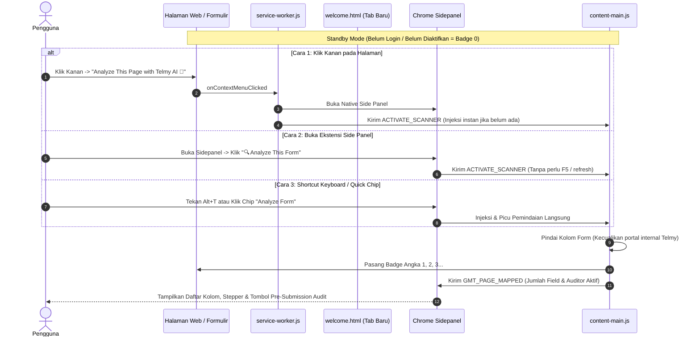

# 🚀 PLAN V6: Extension Onboarding Flow, Welcome Page & Context Menu Integration

> **Status:** SPECIFICATION & IMPLEMENTATION PLAN  
> **Komponen Fokus:** Chrome Extension (`extension/`)  
> **Target Pengalaman Pengguna:** Kelas Industri — *Seamless First-Time User Experience (FTUE)*, visual pin guidance, dan integrasi klik kanan (Context Menu).

---

## 🎯 1. Ringkasan Fitur & Sasaran

Ketika pengguna mengakses halaman formulir atau menggunakan ekstensi Telmy.ai, pengalaman aktivasi harus **bersih, terkontrol, dan instan (On-Demand)**:
1. **Tidak Ada Polusi Badge Otomatis**: Kolom login Telmy (`connect.html`, `/connect`, atau domain internal Telmy) **tidak boleh** memunculkan angka badge 1 2. Ekstensi berada dalam mode *Passive Standby* sebelum diaktivasi.
2. **Tanpa Perlu Refresh Halaman (*Zero Browser Reload*)**: Saat pengguna membuka side panel atau memilih analisis formulir, script diinjeksi secara mulus ke tab aktif secara dinamis (`chrome.scripting.executeScript`) tanpa memaksa pengguna me-refresh browser.
3. **3 Metode Aktivasi Fitur Telmy.ai**:
   - **Metode 1: Klik Kanan pada Halaman (*Right-Click Context Menu*)** -> Pilih *"Analyze This Page with Telmy AI 🤖"*.
   - **Metode 2: Tombol 1-Klik di Side Panel** -> Klik *"🔍 Analyze This Form"* langsung di dalam ekstensi (tidak perlu refresh).
   - **Metode 3: Pintasan Keyboard / Quick Action** -> Tombol pintas `Alt+T` (T = Telmy) atau Quick Chip di chat untuk analisis instan.

---

## 🛠️ 2. Arsitektur Teknis Onboarding Flow & On-Demand Scanner



---

## 📄 3. Rincian Fitur 1: Welcome & Pin Guidance Page (`welcome.html`)

### A. Mekanisme Pembukaan Tab Otomatis
Di dalam `extension/background/service-worker.js`:
```javascript
chrome.runtime.onInstalled.addListener(async (details) => {
  if (details.reason === chrome.runtime.OnInstalledReason.INSTALL) {
    // 1. Catat timestamp instalasi
    await chrome.storage.local.set({ 
      installedAt: new Date().toISOString(),
      onboardingCompleted: false 
    });

    // 2. Buka halaman onboarding secara otomatis di tab baru
    const welcomeUrl = chrome.runtime.getURL('welcome/welcome.html');
    chrome.tabs.create({ url: welcomeUrl });
  } else if (details.reason === chrome.runtime.OnInstalledReason.UPDATE) {
    console.log(`[Telmy.ai] Extension updated to version ${chrome.runtime.getManifest().version}`);
  }
});
```

---

### B. Desain & Konten Halaman `welcome.html` (Apple-Grade Cupertino UI)

Halaman ini diletakkan di `extension/welcome/welcome.html` (didukung oleh `welcome.css` dan `welcome.js`).

#### 1. Header & Hero Section:
* **Badge Sambutan**: *"Welcome to Telmy.ai — Your AI Form-Filling Assistant"*.
* **Headline**: *"You're all set! Let's pin Telmy to your toolbar for easy access."*

#### 2. Visual Pin Guidance (Panduan Visual Interaktif):
* **Ilustrasi / Animasi Halus (Pointer Arrow & Highlight)**:
  - Mockup visual sudut kanan atas browser Chrome.
  - **Langkah 1**: Sorotan animasi (pulsing glow) ke ikon **Extensions Puzzle 🧩**.
  - **Langkah 2**: Dropdown daftar ekstensi terbuka dengan panah melengkung menunjuk ke **Telmy.ai**.
  - **Langkah 3**: Animasi kursor mengklik tombol **Pin 📌**, ikon Telmy berpindah ke toolbar utama.
* **Teks Panduan 3 Langkah Singkat**:
  1. Klik ikon puzzle **🧩 Extensions** di pojok kanan atas browser Anda.
  2. Cari **Telmy.ai** di dalam daftar.
  3. Klik ikon pin **📌** agar Telmy selalu muncul di samping address bar Anda.

#### 3. Struktur Menu Utama Telmy Side Panel:
- **Tab 1: Assistant** (`tab-btn-chat`) — AI Copilot Chatbot & Push-to-Talk Voicebot.
- **Tab 2: Fields & Audit** (`tab-btn-fields`) — Deteksi kolom formulir web & Pre-Submission Auditor.
- **Tab 3: Auto Fill** (`tab-btn-vault`) — 1-Click AutoFill cerdas berbasis Encrypted Profile Vault.

> **Catatan Penataan PDF Form**: Menu PDF Form telah ditarik dari bar tab navigasi utama agar antarmuka lebih fokus dan bersih. PDF Form kini ditempatkan di dalam **Menu Onboarding (Welcome Hero)** tepat di bawah tombol **Translate This Page**, serta dapat dibuka otomatis saat ada dokumen PDF terdeteksi via 1-Click alert banner.

#### 4. Call-to-Action (CTA):
* Tombol utama: **"Try Telmy on Sample Form →"** (Membuka halaman demo uji coba lokal atau live form).
* Tombol sekunder: **"Open Telmy Dashboard"** (Mengarahkan ke `https://telmy-ai.cloud.run/dashboard`).

---

## 🖱️ 4. Rincian Fitur 2: Integrasi Klik Kanan (Context Menu)

### A. Konfigurasi Manifest (`manifest.json`)
Pastikan permission `contextMenus` sudah terdaftar:
```json
{
  "permissions": [
    "sidePanel",
    "storage",
    "tabs",
    "activeTab",
    "scripting",
    "contextMenus"
  ],
  "icons": {
    "16": "assets/icons/icon-16.png",
    "32": "assets/icons/icon-32.png",
    "48": "assets/icons/icon-48.png",
    "128": "assets/icons/icon-128.png"
  }
}
```

---

### B. Registrasi Menu di Service Worker (`service-worker.js`)

```javascript
// Daftarkan Context Menu saat ekstensi diinstall / startup
function setupContextMenus() {
  chrome.contextMenus.removeAll(() => {
    // Menu Utama: Menganalisis seluruh halaman formulir
    chrome.contextMenus.create({
      id: 'telmy_analyze_page',
      title: 'Analyze This Page with Telmy AI 🤖',
      contexts: ['page', 'frame']
    });

    // Menu Kontekstual: Khusus saat pengguna memilih teks atau klik kanan di kolom input
    chrome.contextMenus.create({
      id: 'telmy_explain_selection',
      title: 'Ask Telmy: Explain "%s"',
      contexts: ['selection']
    });

    chrome.contextMenus.create({
      id: 'telmy_inspect_field',
      title: 'Explain This Form Field with Telmy 💡',
      contexts: ['editable']
    });
  });
}

chrome.runtime.onInstalled.addListener(() => {
  setupContextMenus();
});

chrome.runtime.onStartup.addListener(() => {
  setupContextMenus();
});
```

---

### C. Handler Aksi Klik Menu (`chrome.contextMenus.onClicked`)

Saat pengguna mengklik menu **"Analyze This Page with Telmy AI"**:
1. Buka Chrome Native Side Panel pada tab yang aktif.
2. Kirim sinyal ke Content Script (`scanner.js`) untuk memindai kolom form secara instan.
3. Fokuskan Side Panel dan tampilkan ringkasan kolom yang ditemukan.

```javascript
chrome.contextMenus.onClicked.addListener(async (info, tab) => {
  if (!tab || !tab.id) return;

  // 1. Buka Side Panel Telmy.ai di tab tersebut
  if (chrome.sidePanel && chrome.sidePanel.open) {
    try {
      await chrome.sidePanel.open({ tabId: tab.id });
    } catch (err) {
      console.warn('[Context Menu] Error opening sidepanel:', err);
    }
  }

  // 2. Eksekusi aksi berdasarkan menu yang diklik
  if (info.menuItemId === 'telmy_analyze_page') {
    // Picu scanner formulir pada tab aktif
    chrome.tabs.sendMessage(tab.id, { 
      type: 'ACTIVATE_SCANNER', 
      trigger: 'CONTEXT_MENU' 
    });
  } else if (info.menuItemId === 'telmy_explain_selection') {
    // Kirim teks yang diseleksi ke sidepanel untuk dijelaskan AI
    chrome.runtime.sendMessage({
      type: 'EXTERNAL_EXPLAIN_REQUEST',
      queryText: info.selectionText,
      tabId: tab.id
    });
  } else if (info.menuItemId === 'telmy_inspect_field') {
    // Fokuskan inspeksi kolom form target
    chrome.tabs.sendMessage(tab.id, { 
      type: 'INSPECT_CURRENT_ELEMENT' 
    });
  }
});
```

---

## 📁 5. Struktur Berkas yang Dibuat & Dimodifikasi

```text
extension/
├── manifest.json                        <-- Pastikan ada permission "contextMenus"
├── background/
│   └── service-worker.js               <-- Tambah onInstalled listener & contextMenus logic
├── welcome/
│   ├── welcome.html                    <-- Halaman onboarding tab baru
│   ├── welcome.css                     <-- Styling Apple Cupertino + animasi panah pin
│   ├── welcome.js                      <-- Interaktivitas & link demo
│   └── assets/
│       ├── pin-guidance.svg (atau .gif) <-- Panduan visual animasi Pin 📌
│       └── demo-preview.png
└── assets/
    └── icons/
        ├── icon-16.png                 <-- Ikon untuk context menu
        ├── icon-32.png
        └── icon-128.png
```

---

## 📋 6. Checklist Eksekusi Fitur Ini

- [ ] **Langkah 1**: Registrasi permission `contextMenus` di `manifest.json`.
- [ ] **Langkah 2**: Tambahkan event listener `chrome.runtime.onInstalled` di `service-worker.js` untuk membuka `welcome.html`.
- [ ] **Langkah 3**: Buat folder `extension/welcome/` berisi `welcome.html`, `welcome.css`, dan aset grafis panduan Pin 📌.
- [ ] **Langkah 4**: Implementasikan `chrome.contextMenus.create` dan event listener `onClicked` untuk membuka sidepanel.
- [ ] **Langkah 5**: Uji coba live di Chrome via `chrome://extensions` (Unpack / Reload):
  - Uji apakah tab onboarding otomatis terbuka saat di-install pertama kali.
  - Uji apakah panduan visual Pin jelas dan mudah dipahami.
  - Uji klik kanan di halaman formulir web apa saja untuk memunculkan *"Analyze This Page with Telmy AI"*.

---
*Dokumen ini resmi disimpan di `docs/planv6.md` dan siap dieksekusi bersamaan dengan roadmap pengembangan Telmy.ai.*
