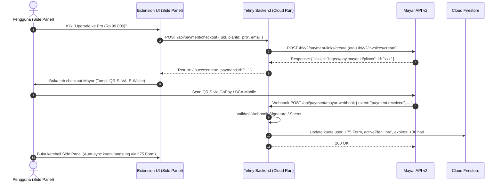

# 📋 MASTER PLAN V9: Migrasi Payment Gateway ke Mayar.id & Restrukturisasi Model Bisnis Telmy.ai

---

## 🎯 1. Ringkasan Eksekutif & Latar Belakang Migrasi

Telmy.ai memigrasikan sistem pembayaran dan monetisasi dari **Lemon Squeezy** ke **Mayar.id** (mengadopsi standar Mayar API v2 & Mayar CLI Skill).

### A. Mengapa Memilih Mayar.id?
1. **Relevansi Pasar Target & Metode Pembayaran Lokal**:
   - Telmy.ai banyak digunakan oleh masyarakat Indonesia (pelamar beasiswa LPDP, CPNS, visa kedutaan, paspor, apostille kementerian).
   - Pengguna di Indonesia mayoritas **tidak memiliki kartu kredit**. Lemon Squeezy mewajibkan kartu kredit internasional/PayPal.
   - Mayar.id menyediakan dukungan instan untuk **QRIS** (GoPay, OVO, ShopeePay, DANA, BCA QR), **Virtual Account bank-bank utama** (BCA, Mandiri, BRI, BNI, Permata), dan kartu kredit/debit internasional.
2. **Struktur Biaya Transaksi & Payout Langsung**:
   - Lemon Squeezy mengenakan potongan *Merchant of Record* hingga 5% + $0.50 per transaksi ditambah konversi valas.
   - Mayar.id memotong biaya transaksi lokal yang sangat efisien (~0.7% untuk QRIS atau flat ~Rp 2.500 untuk VA) dan langsung mencairkan dana (*auto-payout*) ke rekening bank lokal di Indonesia.
3. **Kepatuhan Terhadap Panduan Mayar Skill**:
   - Berdasarkan `mayar-cli/SKILL.md`, integrasi aplikasi wajib menggunakan **Native HTTP requests (`fetch`/`axios`) ke Mayar Headless REST API v2** (`https://api.mayar.id` / `https://api.mayar.club`), sementara Mayar CLI digunakan untuk administrasi terminal/pengujian devops.

---

## 💎 2. Spesifikasi Model Bisnis & 4 Paket Harga (Pricing Tiers)

Model monetisasi Telmy.ai dirancang dengan struktur freemium bertingkat bulanan yang ramah pengguna awam maupun profesional:

```
┌─────────────────┐   ┌──────────────────┐   ┌──────────────────┐   ┌──────────────────┐
│    FREE TIER    │   │     STANDARD     │   │       PRO        │   │       MAX        │
│   5 Form/Bulan  │   │  25 Form/Bulan   │   │  75 Form/Bulan   │   │  200 Form/Bulan  │
│   Rp 0 (Free)   │   │ Rp 49.000 ($3)   │   │ Rp 99.000 ($7)   │   │ Rp 199.000 ($13) │
│  Monthly Reset  │   │   Rp 1.960/form  │   │   Rp 1.320/form  │   │     Rp 995/form  │
└─────────────────┘   └──────────────────┘   └──────────────────┘   └──────────────────┘
```

### Tabel Rincian Paket & Fitur:

| Fitur / Parameter | **Free Tier** | **Standard** | **Pro** *(Best Value)* | **Max** *(Power User / Agency)* |
| :--- | :---: | :---: | :---: | :---: |
| **Harga (IDR)** | **Rp 0** | **Rp 49.000** / bln | **Rp 99.000** / bln | **Rp 199.000** / bln |
| **Harga Patokan (USD)** | $0 | **~$3** | **~$7** | **~$13** |
| **Alokasi Kuota Form** | **5 Form** / bulan | **25 Form** / bulan | **75 Form** / bulan | **200 Form** / bulan |
| **Biaya Efektif per Form** | Gratis | Rp 1.960 / form | **Rp 1.320 / form** | **Rp 995 / form** |
| **Siklus Kuota** | Reset otomatis tiap bulan baru | 30 Hari Aktif (Perpanjangan) | 30 Hari Aktif (Perpanjangan) | 30 Hari Aktif (Perpanjangan) |
| **AI Reasoning Engine** | Gemini 3.5 Flash-Lite | Gemini 3.5 Flash-Lite | Gemini 3.5 Flash-Lite Prioritas | Gemini 3.5 Flash-Lite Prioritas + Vision |
| **Fitur Aksesibilitas (A11y)** | Penuh (14 Tools) | Penuh (14 Tools) | Penuh (14 Tools) | Penuh (14 Tools) |
| **Voice TTS WaveNet** | Kuota standar | Kuota standar | Unlimited Lip-Sync | Unlimited Lip-Sync |
| **Form Pre-Submission Audit** | Dasar | Ya (Lengkap) | Ya (Lengkap) | Ya (Lengkap + Export Laporan) |
| **Universal PDF Explainer** | Maks. 3 halaman/dokumen | Maks. 15 halaman | Maks. 50 halaman | Dokumen tanpa batas |
| **Vault Profil Pintar** | 1 Profil Pribadi | 3 Profil | 10 Profil Multi-Anggota | Profil Tanpa Batas (Bisa untuk Klien) |
| **Metode Pembayaran** | - | QRIS, Virtual Account, Kartu | QRIS, Virtual Account, Kartu | QRIS, Virtual Account, Kartu |

---

## 📊 3. Analisis Biaya Operasional AI & Unit Economics (Gross Margin)

Dengan arsitektur efisien Google Gemini 3.5 Flash-Lite dan Zero-Token Cosine Similarity Cache Telmy:

### A. Rata-Rata Konsumsi Token per 1 Formulir:
- Rata-rata form web/PDF: 15–25 input fields.
- Input tokens (analisis DOM + semantic field parsing): ~2.000 tokens.
- Output tokens (rekomendasi, penjelasan bahasa awam, validasi): ~500 tokens.
- **Biaya Gemini API per form**:
  $$\text{Input: } 2.000 \times \$0.075 / 1\text{M} = \$0.00015$$
  $$\text{Output: } 500 \times \$0.30 / 1\text{M} = \$0.00015$$
  $$\text{Total Biaya AI per form} \approx \$0.00030 \text{ (sekitar Rp 4,8)}$$

### B. Kalkulasi Margin Keuntungan per Paket:

| Paket | Pendapatan (IDR) | Total Beban AI (Gemini + TTS) | Fee Payment Mayar (~1%) | **Laba Kotor (Gross Profit)** | **Gross Margin (%)** |
| :--- | :---: | :---: | :---: | :---: | :---: |
| **Free (5 form)** | Rp 0 | ~Rp 25 / pengguna | Rp 0 | -Rp 25 *(Customer Acquisition)* | - |
| **Standard (25 form)** | Rp 49.000 | ~Rp 120 | ~Rp 500 | **Rp 48.380** | **98.7%** |
| **Pro (75 form)** | Rp 99.000 | ~Rp 360 | ~Rp 1.000 | **Rp 97.640** | **98.6%** |
| **Max (200 form)** | Rp 199.000 | ~Rp 960 | ~Rp 2.000 | **Rp 196.040** | **98.5%** |

> **Kesimpulan Finansial:** Telmy.ai memiliki margin kotor di atas **98%**. Biaya operasional server Cloud Run dan Gemini API tertutup penuh hanya dari 1 pelanggan berbayar pertama.

---

## ⚙️ 4. Mekanisme Teknis Kuota & Auto-Refresh Bulanan

### A. Konsep *Lazy Monthly Refresh* (Zero Cron Overhead)
Untuk tier gratis (Free 5 form/bulan), server **tidak perlu menjalankan cron job berat setiap tengah malam**. Sebagai gantinya, Telmy menerapkan pola **Lazy Monthly Evaluation**:

```javascript
// Struktur Data Kuota di Firestore / Cache:
quota: {
  plan: 'free',                    // 'free' | 'standard' | 'pro' | 'max'
  freeRemaining: 5,
  lastFreeMonth: '2026-10',        // Format YYYY-MM
  subscriptionQuotaRemaining: 0,
  subscriptionExpiresAt: null,     // ISO String untuk paket berbayar 30 hari
  purchasedCreditsRemaining: 0     // Kuota permanen tambahan (jika ada)
}
```

#### Logika Evaluasi saat Request Datang (`getUserQuota`):
1. Ambil tanggal sekarang dalam zona waktu pengguna (format `YYYY-MM`).
2. Jika `quota.lastFreeMonth !== currentMonth`:
   - Reset `quota.freeRemaining = 5`.
   - Update `quota.lastFreeMonth = currentMonth`.
   - Simpan kembali ke database.
3. Dengan metode ini:
   - Pengguna aktif langsung mendapatkan 5 kuota baru di awal bulan.
   - Pengguna tidak aktif tidak membebani database dengan operasi tulis sia-sia.

### B. Urutan Prioritas Pemotongan Kuota (*Expiring-First Strategy*):
Ketika pengguna menganalisis formulir baru, kuota dipotong dengan urutan:
1. **Subscription Quota** (Kuota paket aktif berbayar yang memiliki tanggal kedaluwarsa 30 hari).
2. **Free Monthly Quota** (5 form gratis bulanan yang akan kedaluwarsa akhir bulan).
3. **Purchased Credits** (Kredit permanen tanpa masa berlaku).

---

## 🔌 5. Arsitektur Integrasi Mayar API v2

Berdasarkan spesifikasi Mayar CLI & SKILL.md:
- **Base URL Produksi**: `https://api.mayar.id`
- **Base URL Sandbox**: `https://api.mayar.club`
- **Header Autentikasi**: `Authorization: Bearer <MAYAR_API_KEY>`



### A. Schema Request Pembuatan Checkout ke Mayar Headless API:
```javascript
// Payload dikirim dari Backend Telmy ke Mayar:
const mayarPayload = {
  name: `Telmy.ai ${plan.name} (1 Bulan)`,
  amount: plan.priceIdr, // misal: 99000
  description: `Langganan Telmy.ai: ${plan.forms} Form Guidance Kuota selama 30 Hari.`,
  customer: {
    email: userEmail,
    name: userName || 'Pelanggan Telmy'
  },
  redirectUrl: 'https://telmy.web.app/payment-success.html',
  metadata: {
    userId: uid,
    planId: planId,
    formsGranted: plan.forms
  }
};
```

### B. Schema Webhook Receiver Mayar (`POST /api/payment/mayar-webhook`):
Mayar mengirimkan notifikasi saat pembayaran diverifikasi:
```javascript
router.post('/payment/mayar-webhook', async (req, res) => {
  const event = req.body;
  // Validasi event Mayar (payment.received atau invoice.paid)
  if (event.status === 'paid' || event.event === 'payment.received' || event.type === 'payment.success') {
    const { userId, planId, formsGranted } = event.metadata || {};
    if (userId && planId) {
      await activatePlanSubscription(userId, planId, formsGranted, 30);
    }
  }
  return res.status(200).json({ received: true });
});
```

---

## 📁 6. Rencana Perubahan Berkas (Impact Analysis)

| Berkas | Jenis Perubahan | Detail Perubahan |
| :--- | :---: | :--- |
| **`backend/.env.example`** | Modifikasi | Ganti env `LEMON_SQUEEZY_*` dengan `MAYAR_API_KEY`, `MAYAR_API_URL`, `MAYAR_WEBHOOK_SECRET`, `MAYAR_SIMULATION`. |
| **`backend/src/routes/payment.js`** | Modifikasi | Ganti definisi `PRICING_TIERS` dengan 4 tier (Free, Standard, Pro, Max). Ubah pemanggilan API ke Mayar API v2 (`/hl/v2/...`). Tambahkan webhook handler Mayar. |
| **`backend/src/services/quotaService.js`** | Modifikasi | Tambahkan logika *Lazy Monthly Reset* untuk 5 form gratis tier Free setiap pergantian bulan (`YYYY-MM`). |
| **`extension/sidepanel/sidepanel.html`** | Modifikasi | Ubah modal upgrade kuota (`#sp-quota-modal`) untuk menampilkan 4 pilihan paket dengan harga Rupiah & USD, lengkap dengan logo QRIS dan Virtual Account. |
| **`extension/sidepanel/sidepanel.css`** | Modifikasi | Desain kartu pricing berpenampilan modern (Apple Cupertino Glassmorphism) dengan badge "Paling Populer" di tier Pro. |
| **`extension/sidepanel/sidepanel.js`** | Modifikasi | Hubungkan tombol checkout di setiap tier ke endpoint backend Mayar, dan tangani redirect pembayaran. |
| **`README.md`** | Modifikasi | Perbarui arsitektur sistem dari Lemon Squeezy menjadi Mayar.id Payment Gateway. |

---

## 🚀 7. Roadmap Eksekusi Bertahap

- [ ] **Fase 1: Konfigurasi Backend & Model Kuota Baru**
  - Implementasikan 4 tingkatan harga (Free 5, Standard 25, Pro 75, Max 200) di `payment.js`.
  - Terapkan mekanisme auto-refresh kuota bulanan Free Tier di `quotaService.js`.
- [ ] **Fase 2: Integrasi Endpoint Mayar API v2 & Webhook**
  - Buat helper service `backend/src/services/mayarService.js`.
  - Siapkan mode simulasi instan (`MAYAR_SIMULATION=true`) agar tim developer dan pengujian dapat mengetes checkout tanpa memotong saldo asli.
  - Implementasikan webhook Mayar handler di `/api/payment/mayar-webhook`.
- [ ] **Fase 3: Redesain Antarmuka Ekstensi (Side Panel Pricing Modal)**
  - Tampilkan 3 kartu paket berbayar (Standard, Pro, Max) dan info kuota Free di modal ekstensi.
  - Tambahkan label metode pembayaran lokal (QRIS, BCA, Mandiri, BRI, Visa/Mastercard).
- [ ] **Fase 4: Testing & Verifikasi End-to-End**
  - Uji siklus refresh bulanan kuota gratis.
  - Uji simulasi pembayaran Mayar dan verifikasi pertambahan kuota instan di Firestore.
